# A quick tour of mclust

## Introduction

**mclust** is a contributed R package for model-based clustering,
classification, and density estimation based on finite normal mixture
modelling. It provides functions for parameter estimation via the EM
algorithm for normal mixture models with a variety of covariance
structures, and functions for simulation from these models. Also
included are functions that combine model-based hierarchical clustering,
EM for mixture estimation and the Bayesian Information Criterion (BIC)
in comprehensive strategies for clustering, density estimation and
discriminant analysis. Additional functionalities are available for
displaying and visualizing fitted models along with clustering,
classification, and density estimation results.

This document gives a quick tour of **mclust** (version 6.1.4)
functionalities. It was written in R Markdown, using the
[knitr](https://cran.r-project.org/package=knitr) package for
production. See
[`help(package="mclust")`](https://mclust-org.github.io/mclust/reference)
for further details and references provided by `citation("mclust")`.

\
[`library`](https://rdrr.io/r/base/library.html)`(`[`mclust`](https://mclust-org.github.io/mclust/)`)`\
`##                    __           __ `\
`##    ____ ___  _____/ /_  _______/ /_`\
`` ##   / __ `__ \/ ___/ / / / / ___/ __/ ``\
`##  / / / / / / /__/ / /_/ (__  ) /_  `\
`## /_/ /_/ /_/\___/_/\__,_/____/\__/   version 6.1.4`\
`## Type 'citation("mclust")' for citing this R package in publications.`

## Clustering

\
[`data`](https://rdrr.io/r/utils/data.html)`(``diabetes``)`\
`#-- data corrections (see help("diabetes", package = "mclust")) --#`\
[`names`](https://rdrr.io/r/base/names.html)`(``diabetes``)`` ``<-`` `[`c`](https://rdrr.io/r/base/c.html)`(``"class"``, ``"fpg"``, ``"glucose"``, ``"insulin"``)`\
`diabetes``$``glucose``[``104``]`` ``<-`` ``455`\
`#-----------------------------------------------------------------#`\
`class`` ``<-`` ``diabetes``$``class`\
[`table`](https://rdrr.io/r/base/table.html)`(``class``)`\
`## class`\
`## Chemical   Normal    Overt `\
`##       36       76       33`\
`X`` ``<-`` ``diabetes``[``,``-``1``]`\
[`head`](https://rdrr.io/r/utils/head.html)`(``X``)`\
`##   fpg glucose insulin`\
`## 1  80     356     124`\
`## 2  97     289     117`\
`## 3 105     319     143`\
`## 4  90     356     199`\
`## 5  90     323     240`\
`## 6  86     381     157`\
[`clPairs`](https://mclust-org.github.io/mclust/reference/clPairs.md)`(``X``, ``class``)`

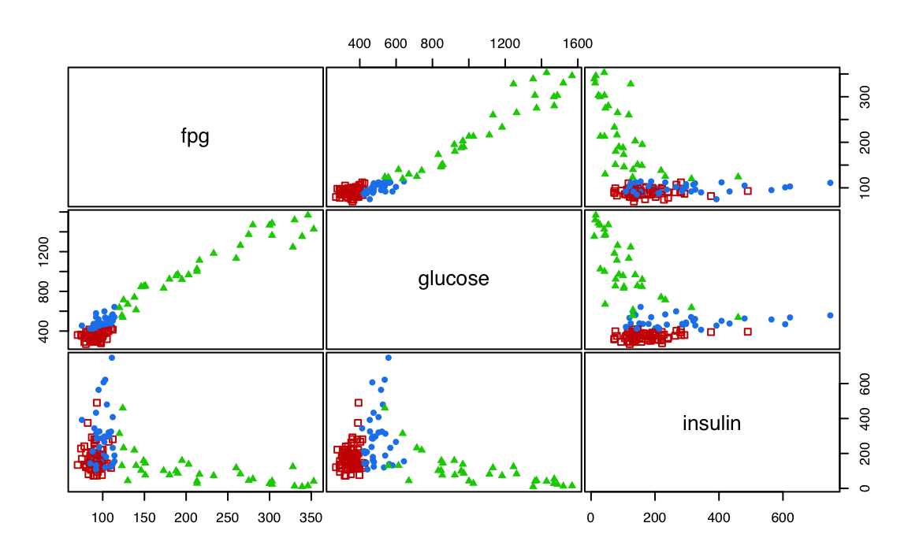

\
\
`BIC`` ``<-`` `[`mclustBIC`](https://mclust-org.github.io/mclust/reference/mclustBIC.md)`(``X``)`\
[`plot`](https://rdrr.io/r/graphics/plot.default.html)`(``BIC``)`

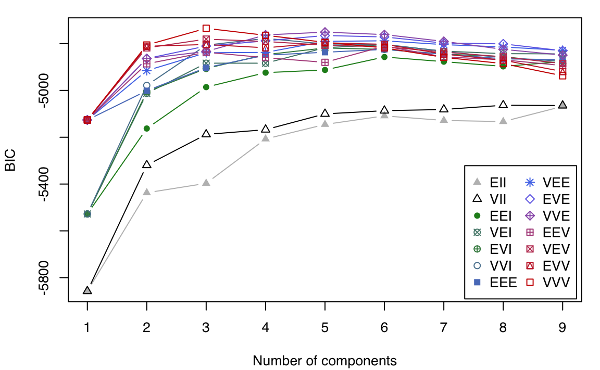

\
[`summary`](https://rdrr.io/r/base/summary.html)`(``BIC``)`\
`## Best BIC values:`\
`##              VVV,3       VVE,5       VVE,6`\
`## BIC      -4734.561 -4750.75832 -4761.35626`\
`## BIC diff     0.000   -16.19685   -26.79479`\
\
`mod1`` ``<-`` `[`Mclust`](https://mclust-org.github.io/mclust/reference/Mclust.md)`(``X``, x ``=`` ``BIC``)`\
[`summary`](https://rdrr.io/r/base/summary.html)`(``mod1``, parameters ``=`` ``TRUE``)`\
`## ---------------------------------------------------- `\
`## Gaussian finite mixture model fitted by EM algorithm `\
`## ---------------------------------------------------- `\
`## `\
`## Mclust VVV (ellipsoidal, varying volume, shape, and orientation) model with 3`\
`## components: `\
`## `\
`##  log-likelihood   n df       BIC      ICL`\
`##       -2295.118 145 29 -4734.561 -4749.16`\
`## `\
`## Clustering table:`\
`##  1  2  3 `\
`## 82 35 28 `\
`## `\
`## Mixing probabilities:`\
`##         1         2         3 `\
`## 0.5553630 0.2479432 0.1966939 `\
`## `\
`## Means:`\
`##              [,1]     [,2]       [,3]`\
`## fpg      91.35843 104.6401  230.32908`\
`## glucose 357.86717 515.7332 1103.21235`\
`## insulin 165.85059 314.5807   81.40487`\
`## `\
`## Variances:`\
`## [,,1]`\
`##              fpg   glucose    insulin`\
`## fpg     61.41309   93.8443   33.84212`\
`## glucose 93.84430 2051.4193  365.21412`\
`## insulin 33.84212  365.2141 2643.75977`\
`## [,,2]`\
`##               fpg    glucose    insulin`\
`## fpg      194.3494   940.1594  -546.2879`\
`## glucose  940.1594  7271.8069 -2775.9918`\
`## insulin -546.2879 -2775.9918 24757.4385`\
`## [,,3]`\
`##               fpg   glucose    insulin`\
`## fpg      5451.219  19936.61  -2473.121`\
`## glucose 19936.610  80705.15 -10272.620`\
`## insulin -2473.121 -10272.62   2243.084`\
\
[`plot`](https://rdrr.io/r/graphics/plot.default.html)`(``mod1``, what ``=`` ``"classification"``)`

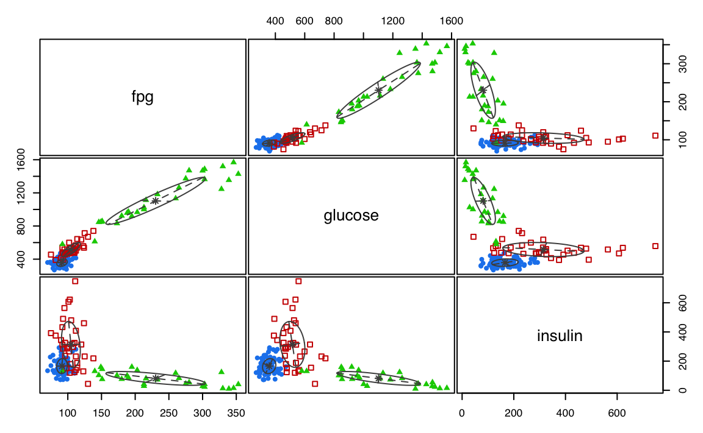

\
[`table`](https://rdrr.io/r/base/table.html)`(``class``, ``mod1``$``classification``)`\
`##           `\
`## class       1  2  3`\
`##   Chemical  8 27  1`\
`##   Normal   74  2  0`\
`##   Overt     0  6 27`\
\
[`plot`](https://rdrr.io/r/graphics/plot.default.html)`(``mod1``, what ``=`` ``"uncertainty"``)`

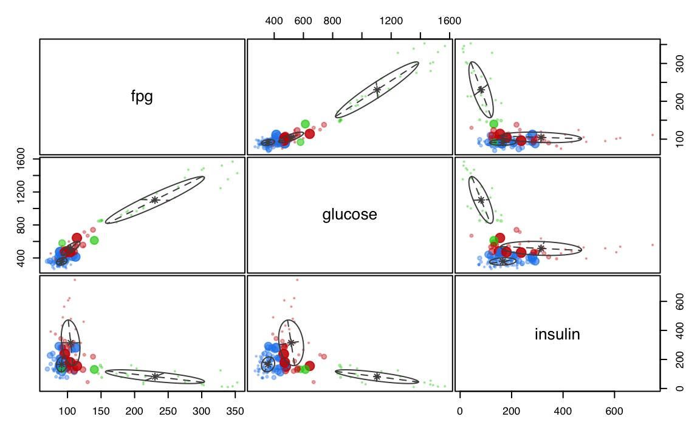

\
\
`ICL`` ``<-`` `[`mclustICL`](https://mclust-org.github.io/mclust/reference/mclustICL.md)`(``X``)`\
[`summary`](https://rdrr.io/r/base/summary.html)`(``ICL``)`\
`## Best ICL values:`\
`##             VVV,3       VVE,4       EVE,5`\
`## ICL      -4749.16 -4778.76438 -4781.49369`\
`## ICL diff     0.00   -29.60428   -32.33359`\
[`plot`](https://rdrr.io/r/graphics/plot.default.html)`(``ICL``)`

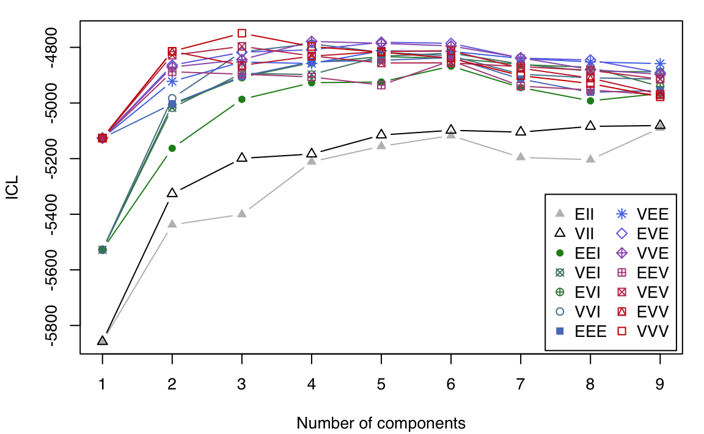

\
\
`LRT`` ``<-`` `[`mclustBootstrapLRT`](https://mclust-org.github.io/mclust/reference/mclustBootstrapLRT.md)`(``X``, modelName ``=`` ``"VVV"``)`\
`LRT`\
`## ------------------------------------------------------------- `\
`## Bootstrap sequential LRT for the number of mixture components `\
`## ------------------------------------------------------------- `\
`## Model        = VVV `\
`## Replications = 999 `\
`##               LRTS bootstrap p-value`\
`## 1 vs 2   369.98537             0.001`\
`## 2 vs 3   121.10652             0.001`\
`## 3 vs 4    19.90071             0.283`

### Initialisation

EM algorithm is used by **mclust** for maximum likelihood estimation.
Initialisation of EM is performed using the partitions obtained from
agglomerative hierarchical clustering. For details see
[`help(mclustBIC)`](https://mclust-org.github.io/mclust/reference/mclustBIC.md)
or
[`help(Mclust)`](https://mclust-org.github.io/mclust/reference/Mclust.md),
and [`help(hc)`](https://mclust-org.github.io/mclust/reference/hc.md).

\
`(``hc1`` ``<-`` `[`hc`](https://mclust-org.github.io/mclust/reference/hc.md)`(``X``, modelName ``=`` ``"VVV"``, use ``=`` ``"SVD"``)``)`\
`## Call:`\
`## hc(data = X, modelName = "VVV", use = "SVD") `\
`## `\
`## Model-Based Agglomerative Hierarchical Clustering `\
`## Model name        = VVV `\
`## Use               = SVD `\
`## Number of objects = 145`\
`BIC1`` ``<-`` `[`mclustBIC`](https://mclust-org.github.io/mclust/reference/mclustBIC.md)`(``X``, initialization ``=`` `[`list`](https://rdrr.io/r/base/list.html)`(``hcPairs ``=`` ``hc1``)``)`` ``# default `\
[`summary`](https://rdrr.io/r/base/summary.html)`(``BIC1``)`\
`## Best BIC values:`\
`##              VVV,3       VVE,5       VVE,6`\
`## BIC      -4734.561 -4750.75832 -4761.35626`\
`## BIC diff     0.000   -16.19685   -26.79479`\
\
`(``hc2`` ``<-`` `[`hc`](https://mclust-org.github.io/mclust/reference/hc.md)`(``X``, modelName ``=`` ``"VVV"``, use ``=`` ``"VARS"``)``)`\
`## Call:`\
`## hc(data = X, modelName = "VVV", use = "VARS") `\
`## `\
`## Model-Based Agglomerative Hierarchical Clustering `\
`## Model name        = VVV `\
`## Use               = VARS `\
`## Number of objects = 145`\
`BIC2`` ``<-`` `[`mclustBIC`](https://mclust-org.github.io/mclust/reference/mclustBIC.md)`(``X``, initialization ``=`` `[`list`](https://rdrr.io/r/base/list.html)`(``hcPairs ``=`` ``hc2``)``)`\
[`summary`](https://rdrr.io/r/base/summary.html)`(``BIC2``)`\
`## Best BIC values:`\
`##             VVV,3       VVE,3      EVE,5`\
`## BIC      -4734.53 -4759.36113 -4765.3420`\
`## BIC diff     0.00   -24.83078   -30.8116`\
\
`(``hc3`` ``<-`` `[`hc`](https://mclust-org.github.io/mclust/reference/hc.md)`(``X``, modelName ``=`` ``"EEE"``, use ``=`` ``"SVD"``)``)`\
`## Call:`\
`## hc(data = X, modelName = "EEE", use = "SVD") `\
`## `\
`## Model-Based Agglomerative Hierarchical Clustering `\
`## Model name        = EEE `\
`## Use               = SVD `\
`## Number of objects = 145`\
`BIC3`` ``<-`` `[`mclustBIC`](https://mclust-org.github.io/mclust/reference/mclustBIC.md)`(``X``, initialization ``=`` `[`list`](https://rdrr.io/r/base/list.html)`(``hcPairs ``=`` ``hc3``)``)`\
[`summary`](https://rdrr.io/r/base/summary.html)`(``BIC3``)`\
`## Best BIC values:`\
`##             VVV,3        VVE,4       VVV,4`\
`## BIC      -4734.53 -4740.185182 -4755.40561`\
`## BIC diff     0.00    -5.654734   -20.87517`

Update BIC by merging the best results:

\
`BIC`` ``<-`` `[`mclustBICupdate`](https://mclust-org.github.io/mclust/reference/mclustBICupdate.md)`(``BIC1``, ``BIC2``, ``BIC3``)`\
[`summary`](https://rdrr.io/r/base/summary.html)`(``BIC``)`\
`## Best BIC values:`\
`##             VVV,3        VVE,4       VVE,5`\
`## BIC      -4734.53 -4740.185182 -4750.75832`\
`## BIC diff     0.00    -5.654828   -16.22797`\
[`plot`](https://rdrr.io/r/graphics/plot.default.html)`(``BIC``)`

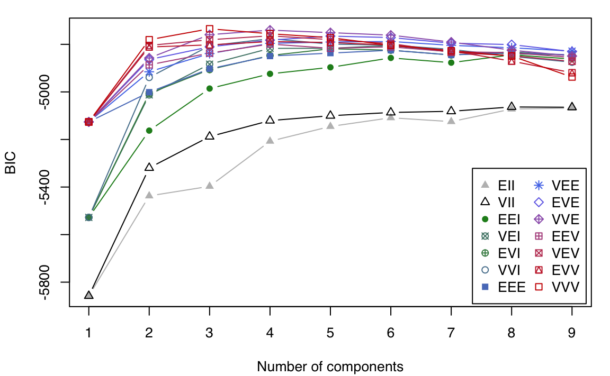

\

Univariate fit using random starting points obtained by creating random
agglomerations (see
[`help(hcRandomPairs)`](https://mclust-org.github.io/mclust/reference/hcRandomPairs.md))
and merging best results:

\
[`data`](https://rdrr.io/r/utils/data.html)`(``galaxies``, package ``=`` ``"MASS"``)`` `\
`galaxies`` ``<-`` ``galaxies`` ``/`` ``1000`\
`BIC`` ``<-`` ``NULL`\
`for``(``j`` ``in`` ``1``:``20``)`\
`{`\
`  ``rBIC`` ``<-`` `[`mclustBIC`](https://mclust-org.github.io/mclust/reference/mclustBIC.md)`(``galaxies``, verbose ``=`` ``FALSE``,`\
`                    initialization ``=`` `[`list`](https://rdrr.io/r/base/list.html)`(``hcPairs ``=`` `[`hcRandomPairs`](https://mclust-org.github.io/mclust/reference/hcRandomPairs.md)`(``galaxies``)``)``)`\
`  ``BIC`` ``<-`` `[`mclustBICupdate`](https://mclust-org.github.io/mclust/reference/mclustBICupdate.md)`(``BIC``, ``rBIC``)`\
`}`\
[`summary`](https://rdrr.io/r/base/summary.html)`(``BIC``)`\
`## Best BIC values:`\
`##                V,3         V,4        V,5`\
`## BIC      -441.6122 -443.399746 -446.34966`\
`## BIC diff    0.0000   -1.787536   -4.73745`\
[`plot`](https://rdrr.io/r/graphics/plot.default.html)`(``BIC``)`

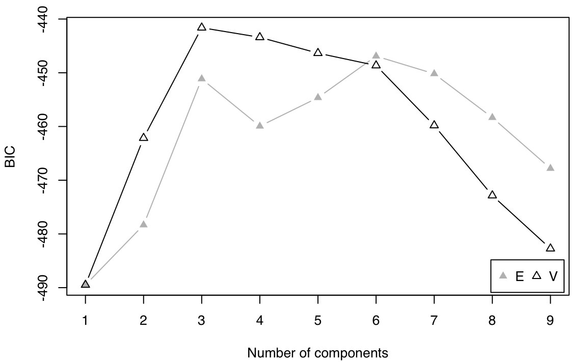

\
`mod`` ``<-`` `[`Mclust`](https://mclust-org.github.io/mclust/reference/Mclust.md)`(``galaxies``, x ``=`` ``BIC``)`\
[`summary`](https://rdrr.io/r/base/summary.html)`(``mod``)`\
`## ---------------------------------------------------- `\
`## Gaussian finite mixture model fitted by EM algorithm `\
`## ---------------------------------------------------- `\
`## `\
`## Mclust V (univariate, unequal variance) model with 3 components: `\
`## `\
`##  log-likelihood  n df       BIC       ICL`\
`##       -203.1792 82  8 -441.6122 -441.6126`\
`## `\
`## Clustering table:`\
`##  1  2  3 `\
`##  3  7 72`

## Classification

### EDDA

\
[`data`](https://rdrr.io/r/utils/data.html)`(``iris``)`\
`class`` ``<-`` ``iris``$``Species`\
[`table`](https://rdrr.io/r/base/table.html)`(``class``)`\
`## class`\
`##     setosa versicolor  virginica `\
`##         50         50         50`\
`X`` ``<-`` ``iris``[``,``1``:``4``]`\
[`head`](https://rdrr.io/r/utils/head.html)`(``X``)`\
`##   Sepal.Length Sepal.Width Petal.Length Petal.Width`\
`## 1          5.1         3.5          1.4         0.2`\
`## 2          4.9         3.0          1.4         0.2`\
`## 3          4.7         3.2          1.3         0.2`\
`## 4          4.6         3.1          1.5         0.2`\
`## 5          5.0         3.6          1.4         0.2`\
`## 6          5.4         3.9          1.7         0.4`\
`mod2`` ``<-`` `[`MclustDA`](https://mclust-org.github.io/mclust/reference/MclustDA.md)`(``X``, ``class``, modelType ``=`` ``"EDDA"``)`\
[`summary`](https://rdrr.io/r/base/summary.html)`(``mod2``)`\
`## ------------------------------------------------ `\
`## Gaussian finite mixture model for classification `\
`## ------------------------------------------------ `\
`## `\
`## EDDA `\
`## ------------------------------------------------ `\
`##  log-likelihood   n df       BIC`\
`##       -187.7097 150 38 -565.8236`\
`##             `\
`## Classes       n     % Model G`\
`##   setosa     50 33.33   VEV 1`\
`##   versicolor 50 33.33   VEV 1`\
`##   virginica  50 33.33   VEV 1`\
`## `\
`## Training confusion matrix`\
`## ------------------------------------------------ `\
`##             Predicted`\
`## Classes      setosa versicolor virginica`\
`##   setosa         50          0         0`\
`##   versicolor      0         47         3`\
`##   virginica       0          0        50`\
`## `\
`## Classification error = 0.0200 `\
`## Brier score          = 0.0127`\
[`plot`](https://rdrr.io/r/graphics/plot.default.html)`(``mod2``, what ``=`` ``"scatterplot"``)`

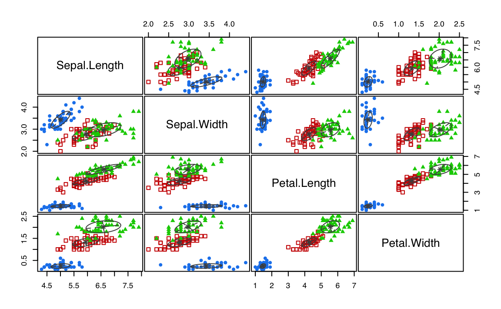

\
[`plot`](https://rdrr.io/r/graphics/plot.default.html)`(``mod2``, what ``=`` ``"classification"``)`

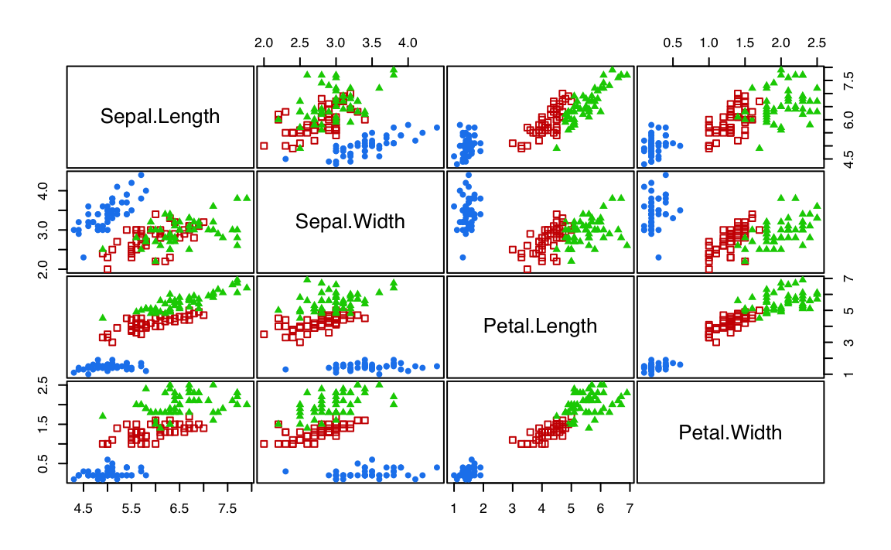

### MclustDA

\
[`data`](https://rdrr.io/r/utils/data.html)`(``banknote``)`\
`class`` ``<-`` ``banknote``$``Status`\
[`table`](https://rdrr.io/r/base/table.html)`(``class``)`\
`## class`\
`## counterfeit     genuine `\
`##         100         100`\
`X`` ``<-`` ``banknote``[``,``-``1``]`\
[`head`](https://rdrr.io/r/utils/head.html)`(``X``)`\
`##   Length  Left Right Bottom  Top Diagonal`\
`## 1  214.8 131.0 131.1    9.0  9.7    141.0`\
`## 2  214.6 129.7 129.7    8.1  9.5    141.7`\
`## 3  214.8 129.7 129.7    8.7  9.6    142.2`\
`## 4  214.8 129.7 129.6    7.5 10.4    142.0`\
`## 5  215.0 129.6 129.7   10.4  7.7    141.8`\
`## 6  215.7 130.8 130.5    9.0 10.1    141.4`\
`mod3`` ``<-`` `[`MclustDA`](https://mclust-org.github.io/mclust/reference/MclustDA.md)`(``X``, ``class``)`\
[`summary`](https://rdrr.io/r/base/summary.html)`(``mod3``)`\
`## ------------------------------------------------ `\
`## Gaussian finite mixture model for classification `\
`## ------------------------------------------------ `\
`## `\
`## MclustDA `\
`## ------------------------------------------------ `\
`##  log-likelihood   n df       BIC`\
`##       -646.0801 200 67 -1647.147`\
`##              `\
`## Classes         n  % Model G`\
`##   counterfeit 100 50   EVE 2`\
`##   genuine     100 50   XXX 1`\
`## `\
`## Training confusion matrix`\
`## ------------------------------------------------ `\
`##              Predicted`\
`## Classes       counterfeit genuine`\
`##   counterfeit         100       0`\
`##   genuine               0     100`\
`## `\
`## Classification error = 0.0000 `\
`## Brier score          = 0.0000`\
[`plot`](https://rdrr.io/r/graphics/plot.default.html)`(``mod3``, what ``=`` ``"scatterplot"``)`

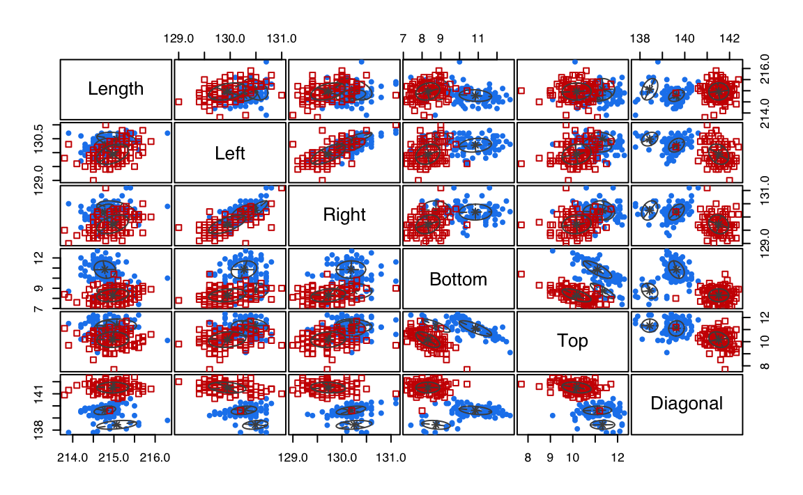

\
[`plot`](https://rdrr.io/r/graphics/plot.default.html)`(``mod3``, what ``=`` ``"classification"``)`

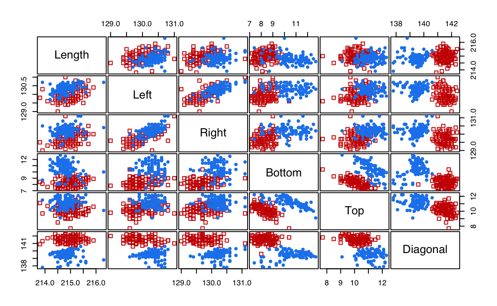

### Cross-validation error

\
`cv`` ``<-`` `[`cvMclustDA`](https://mclust-org.github.io/mclust/reference/cvMclustDA.md)`(``mod2``, nfold ``=`` ``10``)`\
[`str`](https://rdrr.io/r/utils/str.html)`(``cv``)`\
`## List of 6`\
`##  $ classification: Factor w/ 3 levels "setosa","versicolor",..: 1 1 1 1 1 1 1 1 1 1 ...`\
`##  $ z             : num [1:150, 1:3] 1 1 1 1 1 1 1 1 1 1 ...`\
`##   ..- attr(*, "dimnames")=List of 2`\
`##   .. ..$ : NULL`\
`##   .. ..$ : chr [1:3] "setosa" "versicolor" "virginica"`\
`##  $ ce            : num 0.0267`\
`##  $ se.ce         : num 0.0109`\
`##  $ brier         : num 0.0208`\
`##  $ se.brier      : num 0.00738`\
[`unlist`](https://rdrr.io/r/base/unlist.html)`(``cv``[``3``:``6``]``)`\
`##          ce       se.ce       brier    se.brier `\
`## 0.026666667 0.010886621 0.020795887 0.007383247`\
`cv`` ``<-`` `[`cvMclustDA`](https://mclust-org.github.io/mclust/reference/cvMclustDA.md)`(``mod3``, nfold ``=`` ``10``)`\
[`str`](https://rdrr.io/r/utils/str.html)`(``cv``)`\
`## List of 6`\
`##  $ classification: Factor w/ 2 levels "counterfeit",..: 2 2 2 2 2 2 2 2 2 2 ...`\
`##  $ z             : num [1:200, 1:2] 1.56e-06 3.50e-19 5.41e-28 3.33e-20 2.42e-29 ...`\
`##   ..- attr(*, "dimnames")=List of 2`\
`##   .. ..$ : NULL`\
`##   .. ..$ : chr [1:2] "counterfeit" "genuine"`\
`##  $ ce            : num 0.005`\
`##  $ se.ce         : num 0.005`\
`##  $ brier         : num 0.00514`\
`##  $ se.brier      : num 0.00498`\
[`unlist`](https://rdrr.io/r/base/unlist.html)`(``cv``[``3``:``6``]``)`\
`##          ce       se.ce       brier    se.brier `\
`## 0.005000000 0.005000000 0.005135796 0.004980123`

## Density estimation

### Univariate

\
[`data`](https://rdrr.io/r/utils/data.html)`(``acidity``)`\
`mod4`` ``<-`` `[`densityMclust`](https://mclust-org.github.io/mclust/reference/densityMclust.md)`(``acidity``)`

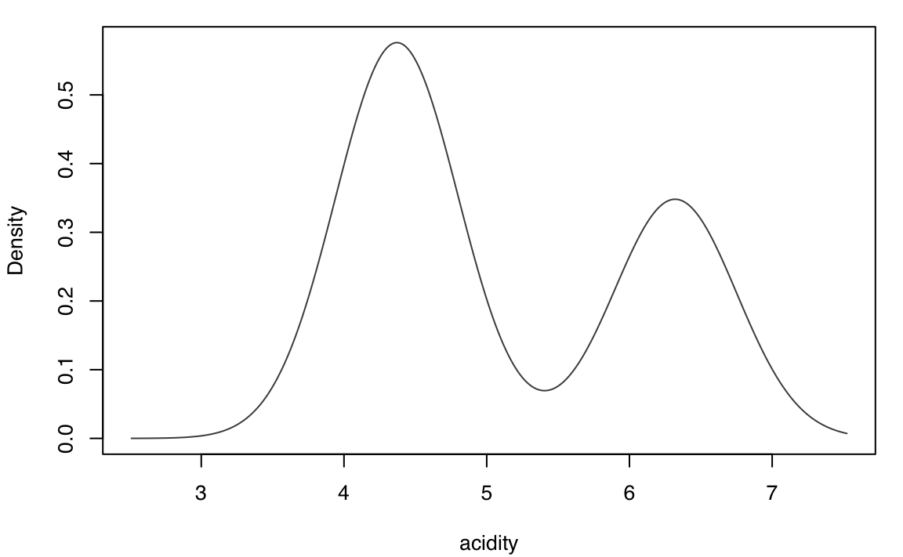

\
[`summary`](https://rdrr.io/r/base/summary.html)`(``mod4``)`\
`## ------------------------------------------------------- `\
`## Density estimation via Gaussian finite mixture modeling `\
`## ------------------------------------------------------- `\
`## `\
`## Mclust E (univariate, equal variance) model with 2 components: `\
`## `\
`##  log-likelihood   n df       BIC       ICL`\
`##       -185.9493 155  4 -392.0723 -398.5554`\
[`plot`](https://rdrr.io/r/graphics/plot.default.html)`(``mod4``, what ``=`` ``"BIC"``)`

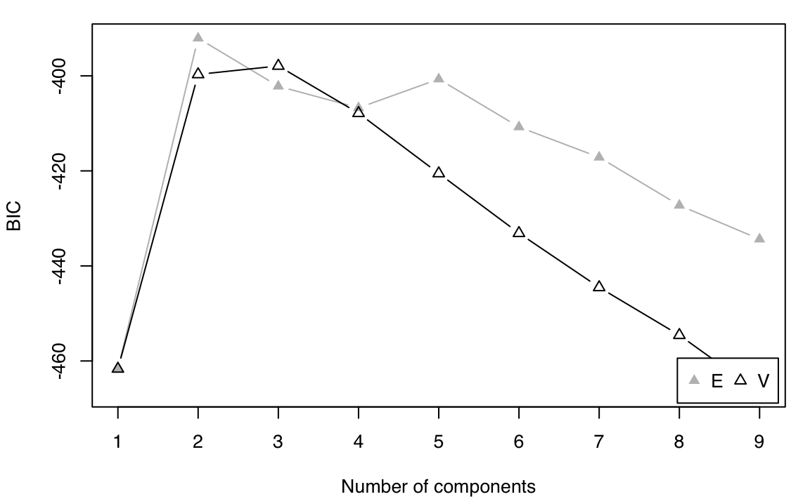

\
[`plot`](https://rdrr.io/r/graphics/plot.default.html)`(``mod4``, what ``=`` ``"density"``, data ``=`` ``acidity``, breaks ``=`` ``15``)`

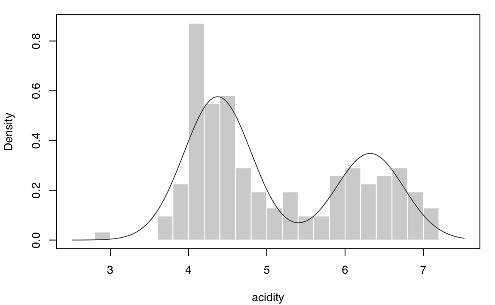

\
[`plot`](https://rdrr.io/r/graphics/plot.default.html)`(``mod4``, what ``=`` ``"diagnostic"``, type ``=`` ``"cdf"``)`

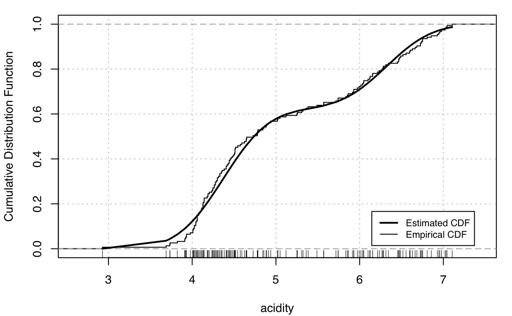

\
[`plot`](https://rdrr.io/r/graphics/plot.default.html)`(``mod4``, what ``=`` ``"diagnostic"``, type ``=`` ``"qq"``)`

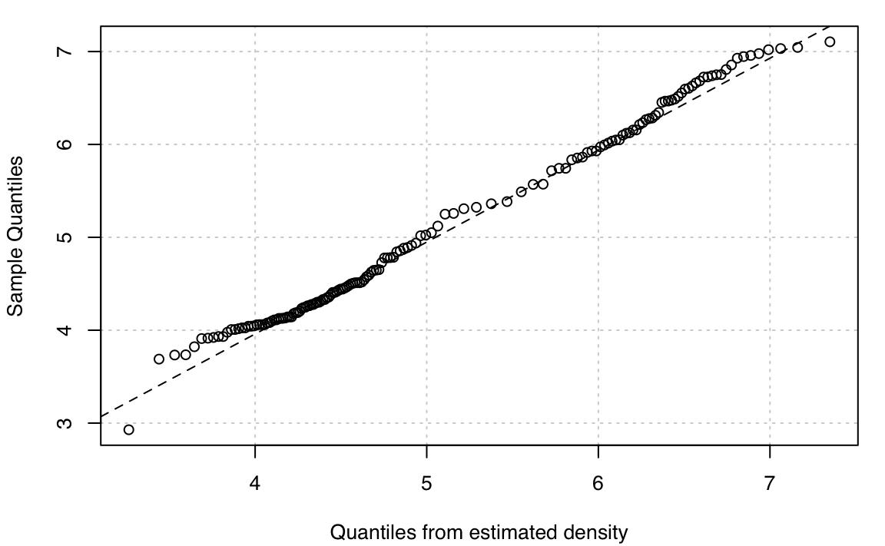

### Multivariate

\
[`data`](https://rdrr.io/r/utils/data.html)`(``faithful``)`\
`mod5`` ``<-`` `[`densityMclust`](https://mclust-org.github.io/mclust/reference/densityMclust.md)`(``faithful``)`

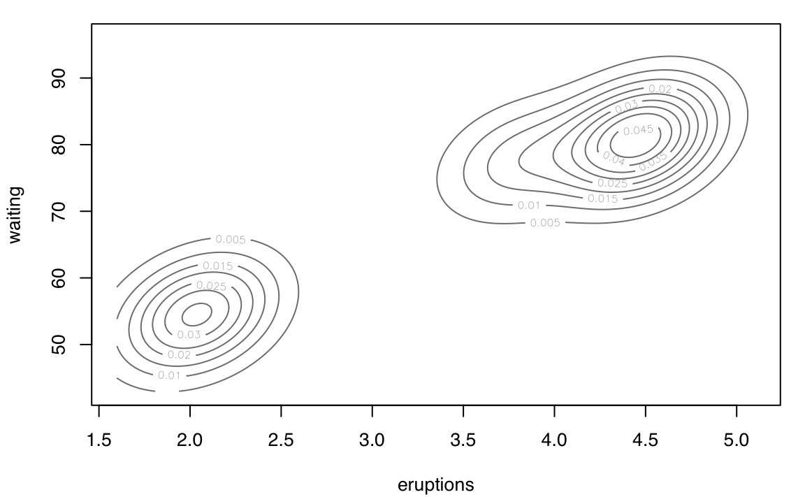

\
[`summary`](https://rdrr.io/r/base/summary.html)`(``mod5``)`\
`## ------------------------------------------------------- `\
`## Density estimation via Gaussian finite mixture modeling `\
`## ------------------------------------------------------- `\
`## `\
`## Mclust EEE (ellipsoidal, equal volume, shape and orientation) model with 3`\
`## components: `\
`## `\
`##  log-likelihood   n df       BIC       ICL`\
`##       -1126.326 272 11 -2314.316 -2357.824`\
[`plot`](https://rdrr.io/r/graphics/plot.default.html)`(``mod5``, what ``=`` ``"BIC"``)`

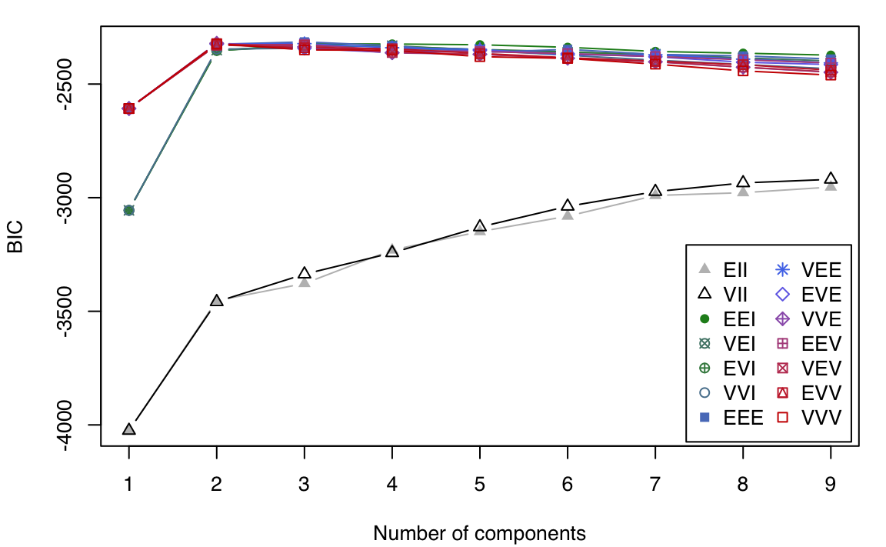

\
[`plot`](https://rdrr.io/r/graphics/plot.default.html)`(``mod5``, what ``=`` ``"density"``, type ``=`` ``"hdr"``, data ``=`` ``faithful``, points.cex ``=`` ``0.5``)`

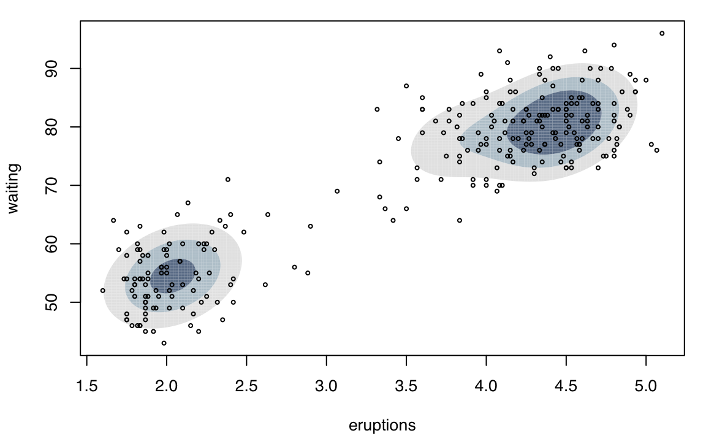

\
[`plot`](https://rdrr.io/r/graphics/plot.default.html)`(``mod5``, what ``=`` ``"density"``, type ``=`` ``"persp"``)`

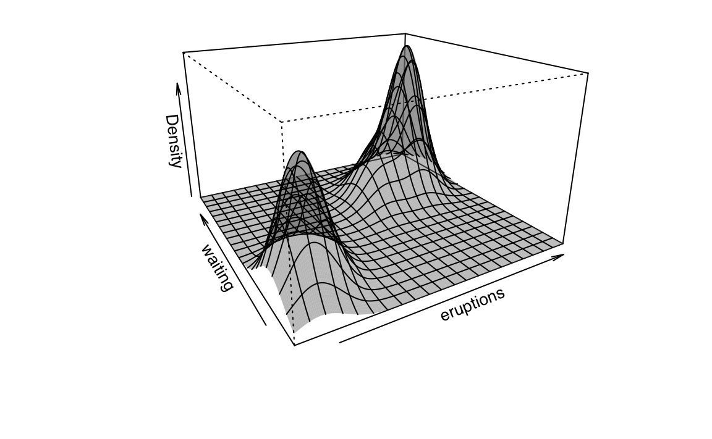

## Bootstrap inference

\
`boot1`` ``<-`` `[`MclustBootstrap`](https://mclust-org.github.io/mclust/reference/MclustBootstrap.md)`(``mod1``, nboot ``=`` ``999``, type ``=`` ``"bs"``)`\
[`summary`](https://rdrr.io/r/base/summary.html)`(``boot1``, what ``=`` ``"se"``)`\
`## ---------------------------------------------------------- `\
`## Resampling standard errors `\
`## ---------------------------------------------------------- `\
`## Model                      = VVV `\
`## Num. of mixture components = 3 `\
`## Replications               = 999 `\
`## Type                       = nonparametric bootstrap `\
`## `\
`## Mixing probabilities:`\
`##          1          2          3 `\
`## 0.04962408 0.04679956 0.03568767 `\
`## `\
`## Means:`\
`##                1         2        3`\
`## fpg     1.029210  3.431536 16.45148`\
`## glucose 7.348229 23.102112 63.57099`\
`## insulin 6.890494 32.494958 10.35781`\
`## `\
`## Variances:`\
`## [,,1]`\
`##              fpg   glucose   insulin`\
`## fpg     11.22247  51.32446  54.33822`\
`## glucose 51.32446 491.07894 370.15616`\
`## insulin 54.33822 370.15616 559.97118`\
`## [,,2]`\
`##              fpg   glucose   insulin`\
`## fpg      63.0556  414.6464  448.4747`\
`## glucose 414.6464 3039.4632 3016.3035`\
`## insulin 448.4747 3016.3035 7049.5005`\
`## [,,3]`\
`##              fpg   glucose   insulin`\
`## fpg     1003.569  3970.504  680.3030`\
`## glucose 3970.504 17898.128 2492.8805`\
`## insulin  680.303  2492.881  588.4059`\
[`summary`](https://rdrr.io/r/base/summary.html)`(``boot1``, what ``=`` ``"ci"``)`\
`## ---------------------------------------------------------- `\
`## Resampling confidence intervals `\
`## ---------------------------------------------------------- `\
`## Model                      = VVV `\
`## Num. of mixture components = 3 `\
`## Replications               = 999 `\
`## Type                       = nonparametric bootstrap `\
`## Confidence level           = 0.95 `\
`## `\
`## Mixing probabilities:`\
`##               1         2         3`\
`## 2.5%  0.4609834 0.1469903 0.1311157`\
`## 97.5% 0.6607129 0.3354713 0.2701468`\
`## `\
`## Means:`\
`## [,,1]`\
`##            fpg  glucose  insulin`\
`## 2.5%  89.41502 344.5513 153.5648`\
`## 97.5% 93.43859 373.0637 180.4059`\
`## [,,2]`\
`##             fpg  glucose  insulin`\
`## 2.5%   98.15373 475.4215 258.5614`\
`## 97.5% 111.47178 567.0759 386.4861`\
`## [,,3]`\
`##            fpg  glucose   insulin`\
`## 2.5%  198.4823  977.025  63.04963`\
`## 97.5% 263.9015 1228.576 103.91638`\
`## `\
`## Variances:`\
`## [,,1]`\
`##            fpg  glucose  insulin`\
`## 2.5%  39.89112 1208.988 1722.407`\
`## 97.5% 83.56151 3139.945 3959.596`\
`## [,,2]`\
`##             fpg   glucose  insulin`\
`## 2.5%   89.47421  2338.032 13035.79`\
`## 97.5% 336.72367 14195.303 39635.30`\
`## [,,3]`\
`##            fpg   glucose  insulin`\
`## 2.5%  3347.581  47557.08 1320.557`\
`## 97.5% 7267.330 117148.25 3615.588`

\
[`plot`](https://rdrr.io/r/graphics/plot.default.html)`(``boot1``, what ``=`` ``"pro"``)`\
[`plot`](https://rdrr.io/r/graphics/plot.default.html)`(``boot1``, what ``=`` ``"mean"``)`

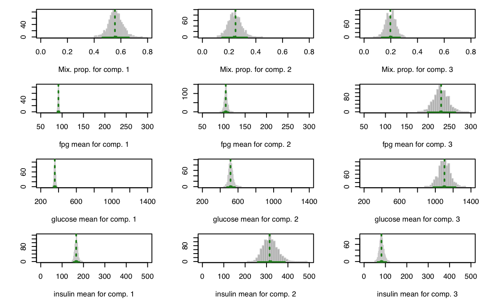

\
`boot4`` ``<-`` `[`MclustBootstrap`](https://mclust-org.github.io/mclust/reference/MclustBootstrap.md)`(``mod4``, nboot ``=`` ``999``, type ``=`` ``"bs"``)`\
[`summary`](https://rdrr.io/r/base/summary.html)`(``boot4``, what ``=`` ``"se"``)`\
`## ---------------------------------------------------------- `\
`## Resampling standard errors `\
`## ---------------------------------------------------------- `\
`## Model                      = E `\
`## Num. of mixture components = 2 `\
`## Replications               = 999 `\
`## Type                       = nonparametric bootstrap `\
`## `\
`## Mixing probabilities:`\
`##          1          2 `\
`## 0.04130937 0.04130937 `\
`## `\
`## Means:`\
`##          1          2 `\
`## 0.04669993 0.06719883 `\
`## `\
`## Variances:`\
`##          1          2 `\
`## 0.02376885 0.02376885`\
[`summary`](https://rdrr.io/r/base/summary.html)`(``boot4``, what ``=`` ``"ci"``)`\
`## ---------------------------------------------------------- `\
`## Resampling confidence intervals `\
`## ---------------------------------------------------------- `\
`## Model                      = E `\
`## Num. of mixture components = 2 `\
`## Replications               = 999 `\
`## Type                       = nonparametric bootstrap `\
`## Confidence level           = 0.95 `\
`## `\
`## Mixing probabilities:`\
`##               1         2`\
`## 2.5%  0.5364895 0.3004131`\
`## 97.5% 0.6995869 0.4635105`\
`## `\
`## Means:`\
`##              1        2`\
`## 2.5%  4.279055 6.184439`\
`## 97.5% 4.461108 6.449465`\
`## `\
`## Variances:`\
`##               1         2`\
`## 2.5%  0.1395796 0.1395796`\
`## 97.5% 0.2317769 0.2317769`

\
[`plot`](https://rdrr.io/r/graphics/plot.default.html)`(``boot4``, what ``=`` ``"pro"``)`\
[`plot`](https://rdrr.io/r/graphics/plot.default.html)`(``boot4``, what ``=`` ``"mean"``)`

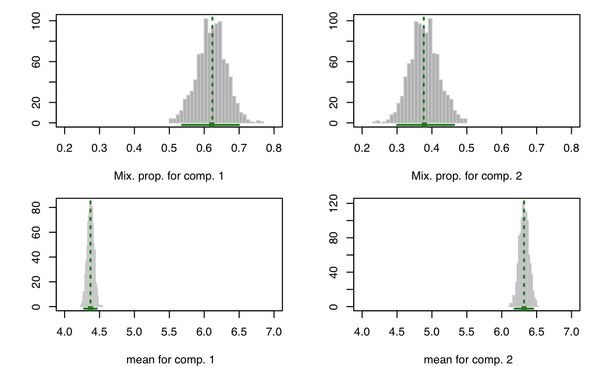

## Dimension reduction

### Clustering

\
`mod1dr`` ``<-`` `[`MclustDR`](https://mclust-org.github.io/mclust/reference/MclustDR.md)`(``mod1``)`\
[`summary`](https://rdrr.io/r/base/summary.html)`(``mod1dr``)`\
`## ----------------------------------------------------------------- `\
`## Dimension reduction for model-based clustering and classification `\
`## ----------------------------------------------------------------- `\
`## `\
`## Mixture model type: Mclust (VVV, 3) `\
`##         `\
`## Clusters  n`\
`##        1 82`\
`##        2 35`\
`##        3 28`\
`## `\
`## Estimated basis vectors: `\
`##              Dir1     Dir2`\
`## fpg      0.884389  0.92601`\
`## glucose -0.466586 -0.20579`\
`## insulin -0.012419 -0.31647`\
`## `\
`##               Dir1      Dir2`\
`## Eigenvalues  1.371   0.41864`\
`## Cum. %      76.607 100.00000`\
[`plot`](https://rdrr.io/r/graphics/plot.default.html)`(``mod1dr``, what ``=`` ``"pairs"``)`

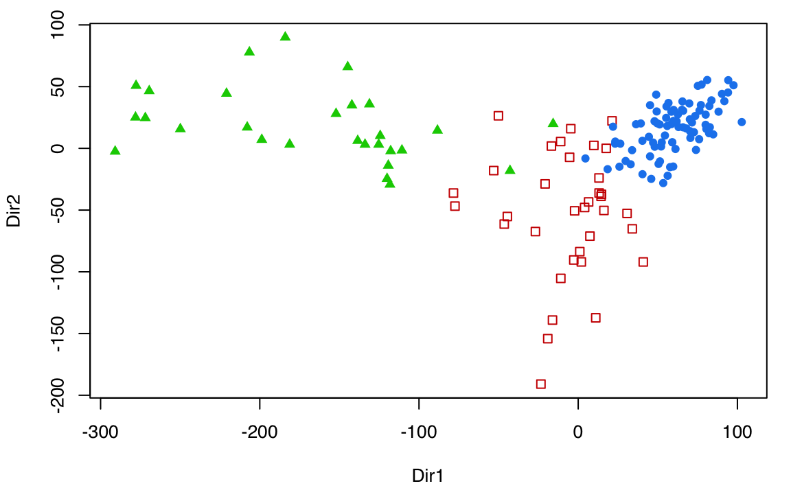

\
[`plot`](https://rdrr.io/r/graphics/plot.default.html)`(``mod1dr``, what ``=`` ``"boundaries"``, ngrid ``=`` ``200``)`

\
\
`mod1dr`` ``<-`` `[`MclustDR`](https://mclust-org.github.io/mclust/reference/MclustDR.md)`(``mod1``, lambda ``=`` ``1``)`\
[`summary`](https://rdrr.io/r/base/summary.html)`(``mod1dr``)`\
`## ----------------------------------------------------------------- `\
`## Dimension reduction for model-based clustering and classification `\
`## ----------------------------------------------------------------- `\
`## `\
`## Mixture model type: Mclust (VVV, 3) `\
`##         `\
`## Clusters  n`\
`##        1 82`\
`##        2 35`\
`##        3 28`\
`## `\
`## Estimated basis vectors: `\
`##              Dir1     Dir2`\
`## fpg      0.884389  0.92601`\
`## glucose -0.466586 -0.20579`\
`## insulin -0.012419 -0.31647`\
`## `\
`##               Dir1      Dir2`\
`## Eigenvalues  1.371   0.41864`\
`## Cum. %      76.607 100.00000`\
[`plot`](https://rdrr.io/r/graphics/plot.default.html)`(``mod1dr``, what ``=`` ``"scatterplot"``)`

\
[`plot`](https://rdrr.io/r/graphics/plot.default.html)`(``mod1dr``, what ``=`` ``"boundaries"``, ngrid ``=`` ``200``)`

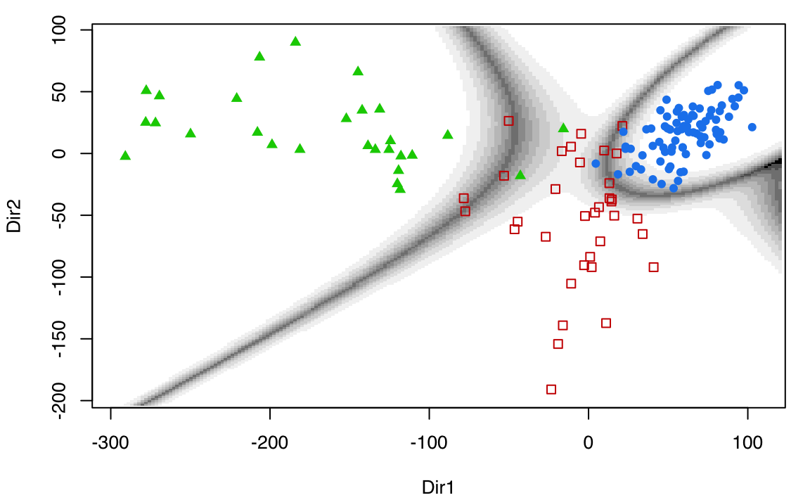

### Classification

\
`mod2dr`` ``<-`` `[`MclustDR`](https://mclust-org.github.io/mclust/reference/MclustDR.md)`(``mod2``)`\
[`summary`](https://rdrr.io/r/base/summary.html)`(``mod2dr``)`\
`## ----------------------------------------------------------------- `\
`## Dimension reduction for model-based clustering and classification `\
`## ----------------------------------------------------------------- `\
`## `\
`## Mixture model type: EDDA `\
`##             `\
`## Classes       n Model G`\
`##   setosa     50   VEV 1`\
`##   versicolor 50   VEV 1`\
`##   virginica  50   VEV 1`\
`## `\
`## Estimated basis vectors: `\
`##                  Dir1      Dir2`\
`## Sepal.Length  0.20874 -0.006532`\
`## Sepal.Width   0.38620 -0.586611`\
`## Petal.Length -0.55401  0.252562`\
`## Petal.Width  -0.70735 -0.769453`\
`## `\
`##                Dir1       Dir2`\
`## Eigenvalues  1.8813   0.098592`\
`## Cum. %      95.0204 100.000000`\
[`plot`](https://rdrr.io/r/graphics/plot.default.html)`(``mod2dr``, what ``=`` ``"scatterplot"``)`

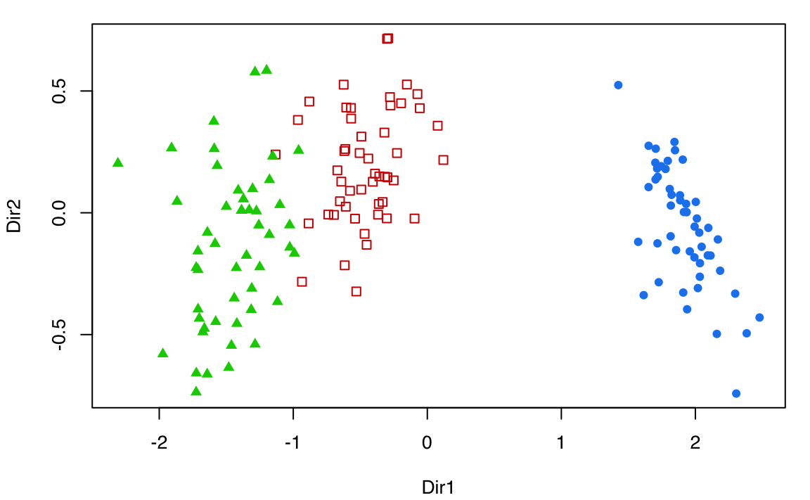

\
[`plot`](https://rdrr.io/r/graphics/plot.default.html)`(``mod2dr``, what ``=`` ``"boundaries"``, ngrid ``=`` ``200``)`

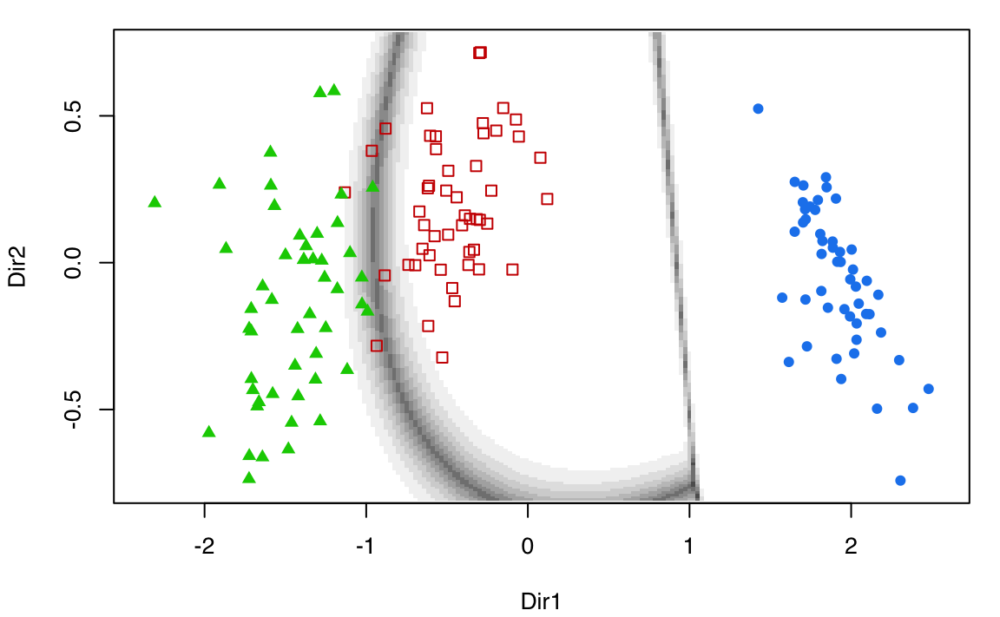

\
\
`mod3dr`` ``<-`` `[`MclustDR`](https://mclust-org.github.io/mclust/reference/MclustDR.md)`(``mod3``)`\
[`summary`](https://rdrr.io/r/base/summary.html)`(``mod3dr``)`\
`## ----------------------------------------------------------------- `\
`## Dimension reduction for model-based clustering and classification `\
`## ----------------------------------------------------------------- `\
`## `\
`## Mixture model type: MclustDA `\
`##              `\
`## Classes         n Model G`\
`##   counterfeit 100   EVE 2`\
`##   genuine     100   XXX 1`\
`## `\
`## Estimated basis vectors: `\
`##              Dir1     Dir2`\
`## Length   -0.07016 -0.25690`\
`## Left     -0.36888 -0.19963`\
`## Right     0.29525 -0.10111`\
`## Bottom    0.54683  0.46254`\
`## Top       0.55720  0.41370`\
`## Diagonal -0.40290  0.70628`\
`## `\
`##                Dir1     Dir2`\
`## Eigenvalues  1.7188   1.0607`\
`## Cum. %      61.8373 100.0000`\
[`plot`](https://rdrr.io/r/graphics/plot.default.html)`(``mod3dr``, what ``=`` ``"scatterplot"``)`

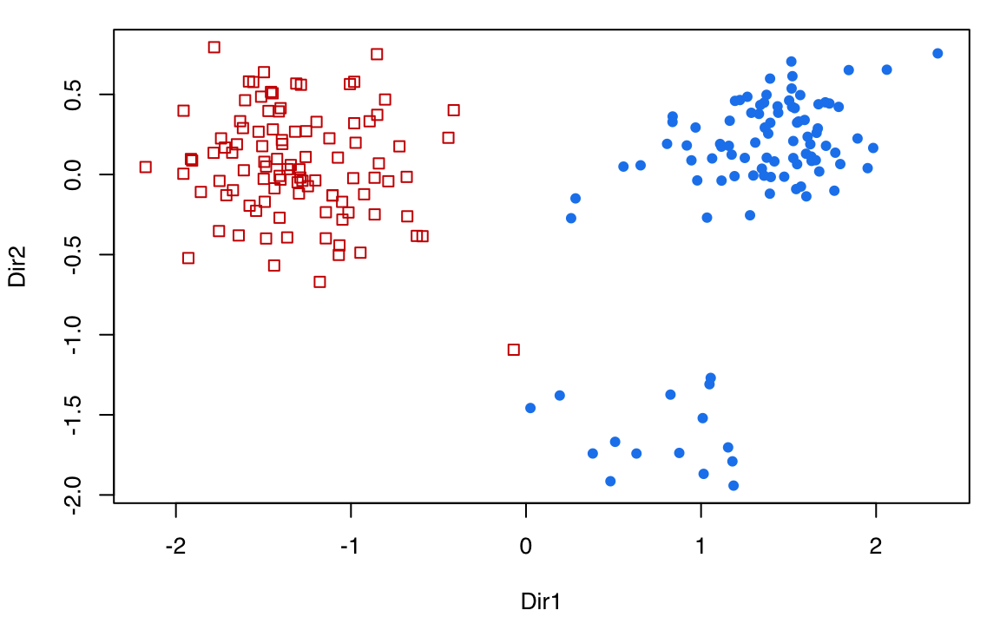

\
[`plot`](https://rdrr.io/r/graphics/plot.default.html)`(``mod3dr``, what ``=`` ``"boundaries"``, ngrid ``=`` ``200``)`

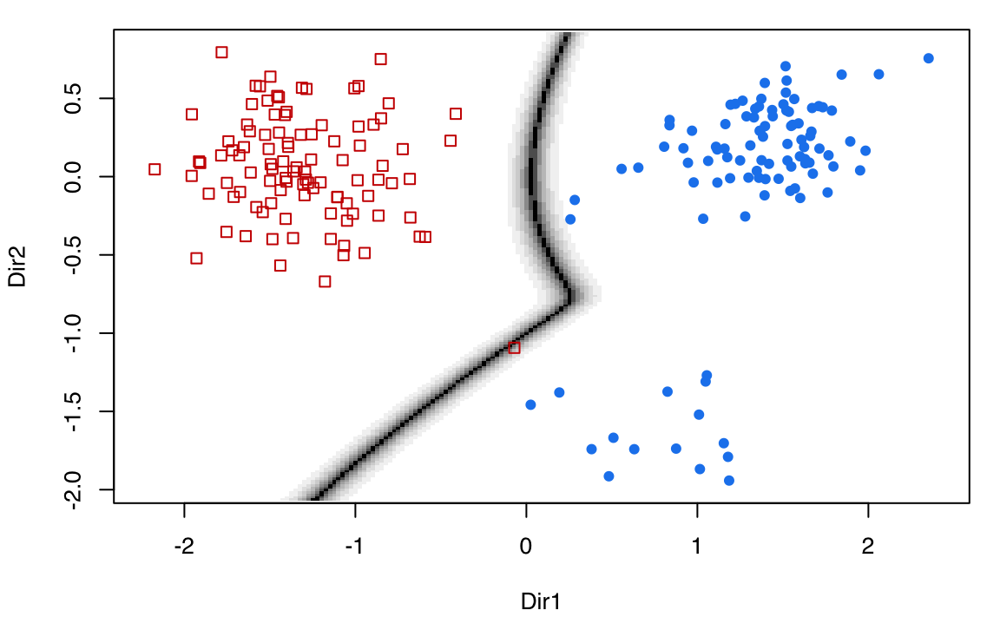

\

## Using colorblind-friendly palettes

Most of the graphs produced by **mclust** use colors that by default are
defined in the following options:

\
[`mclust.options`](https://mclust-org.github.io/mclust/reference/mclust.options.md)`(``"bicPlotColors"``)`\
`##       EII       VII       EEI       EVI       VEI       VVI       EEE       VEE `\
`##    "gray"   "black" "#218B21" "#41884F" "#508476" "#58819C" "#597DC3" "#5178EA" `\
`##       EVE       VVE       EEV       VEV       EVV       VVV         E         V `\
`## "#716EE7" "#9B60B8" "#B2508B" "#C03F60" "#C82A36" "#CC0000"    "gray"   "black"`\
[`mclust.options`](https://mclust-org.github.io/mclust/reference/mclust.options.md)`(``"classPlotColors"``)`\
`##  [1] "dodgerblue2"    "red3"           "green3"         "slateblue"     `\
`##  [5] "darkorange"     "skyblue1"       "violetred4"     "forestgreen"   `\
`##  [9] "steelblue4"     "slategrey"      "brown"          "black"         `\
`## [13] "darkseagreen"   "darkgoldenrod3" "olivedrab"      "royalblue"     `\
`## [17] "tomato4"        "cyan2"          "springgreen2"`

The first option controls colors used for plotting BIC, ICL, etc.
curves, whereas the second option is used to assign colors for
indicating clusters or classes when plotting data.

Starting with R version 4.0, the function can be used for retrieving
colors from some pre-defined palettes. For instance

\
[`palette.colors`](https://rdrr.io/r/grDevices/palette.html)`(``palette ``=`` ``"Okabe-Ito"``)`

returns a color-blind-friendly palette for individuals suffering from
protanopia or deuteranopia, the two most common forms of inherited color
blindness. For earlier versions of R such palette can be defined as:

\
`cbPalette`` ``<-`` `[`c`](https://rdrr.io/r/base/c.html)`(``"#000000"``, ``"#E69F00"``, ``"#56B4E9"``, ``"#009E73"``, ``"#F0E442"``, ``"#0072B2"``, `\
`"#D55E00"``, ``"#CC79A7"``, ``"#999999"``)`

and then assigned to the **mclust** options as follows:

\
`bicPlotColors`` ``<-`` `[`mclust.options`](https://mclust-org.github.io/mclust/reference/mclust.options.md)`(``"bicPlotColors"``)`\
`bicPlotColors``[``1``:``14``]`` ``<-`` `[`c`](https://rdrr.io/r/base/c.html)`(``cbPalette``, ``cbPalette``[``1``:``5``]``)`\
[`mclust.options`](https://mclust-org.github.io/mclust/reference/mclust.options.md)`(``"bicPlotColors"`` ``=`` ``bicPlotColors``)`\
[`mclust.options`](https://mclust-org.github.io/mclust/reference/mclust.options.md)`(``"classPlotColors"`` ``=`` ``cbPalette``[``-``1``]``)`\
\
[`clPairs`](https://mclust-org.github.io/mclust/reference/clPairs.md)`(``iris``[``,``-``5``]``, ``iris``$``Species``)`

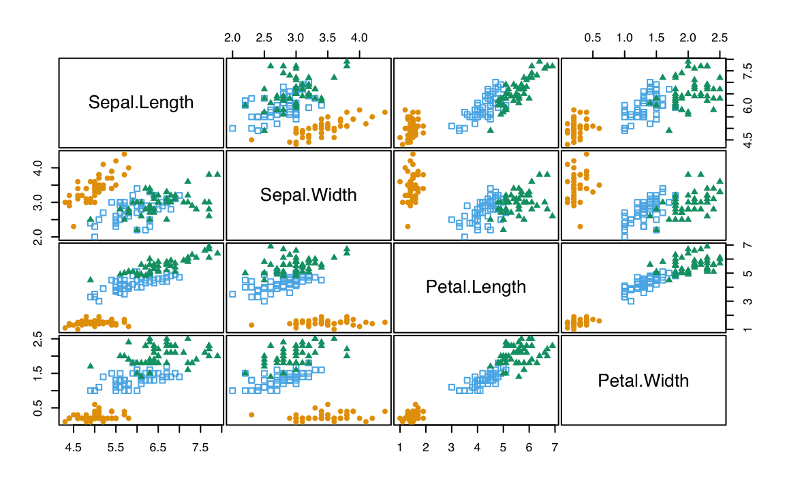

\
`mod`` ``<-`` `[`Mclust`](https://mclust-org.github.io/mclust/reference/Mclust.md)`(``iris``[``,``-``5``]``)`\
[`plot`](https://rdrr.io/r/graphics/plot.default.html)`(``mod``, what ``=`` ``"BIC"``)`

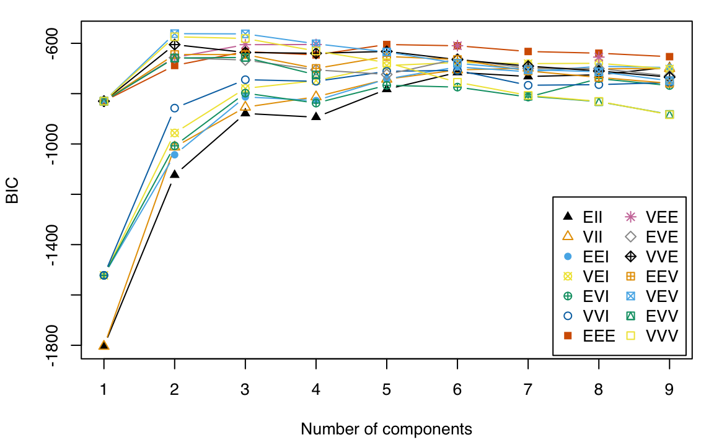

\
[`plot`](https://rdrr.io/r/graphics/plot.default.html)`(``mod``, what ``=`` ``"classification"``)`

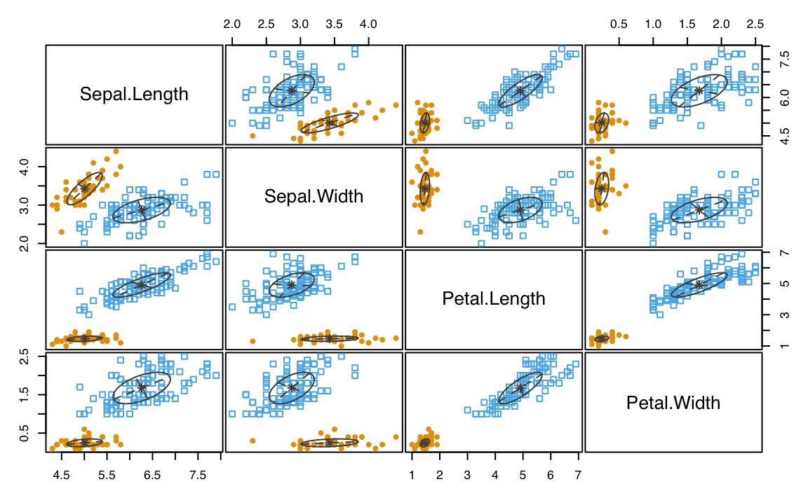

If needed, users can easily define their own palettes following the same
procedure outlined above.

\
\

## References

Scrucca L., Fraley C., Murphy T. B. and Raftery A. E. (2023)
*Model-Based Clustering, Classification, and Density Estimation Using
mclust in R*. Chapman & Hall/CRC, ISBN: 978-1032234953,
<https://mclust-org.github.io/book/>

Scrucca L., Fop M., Murphy T. B. and Raftery A. E. (2016) mclust 5:
clustering, classification and density estimation using Gaussian finite
mixture models, *The R Journal*, 8/1, pp. 205-233.
<https://journal.r-project.org/articles/RJ-2016-021/RJ-2016-021.pdf>

Fraley C. and Raftery A. E. (2002) Model-based clustering, discriminant
analysis and density estimation, *Journal of the American Statistical
Association*, 97/458, pp. 611-631.

------------------------------------------------------------------------

\
[`sessionInfo`](https://rdrr.io/r/utils/sessionInfo.html)`(``)`\
`## R version 4.6.2 (2026-10-29)`\
`## Platform: aarch64-apple-darwin23`\
`## Running under: macOS Golden Gate 27.2.1`\
`## `\
`## Matrix products: default`\
`## BLAS:   /Library/Frameworks/R.framework/Versions/4.6/Resources/lib/libRblas.0.dylib `\
`## LAPACK: /Library/Frameworks/R.framework/Versions/4.6/Resources/lib/libRlapack.dylib;  LAPACK version 3.12.1`\
`## `\
`## locale:`\
`## [1] en_US.UTF-8/en_US.UTF-8/en_US.UTF-8/C/en_US.UTF-8/en_US.UTF-8`\
`## `\
`## time zone: Europe/Rome`\
`## tzcode source: internal`\
`## `\
`## attached base packages:`\
`## [1] stats     graphics  grDevices utils     datasets  methods   base     `\
`## `\
`## other attached packages:`\
`## [1] mclust_6.1.4 knitr_1.52  `\
`## `\
`## loaded via a namespace (and not attached):`\
`##  [1] digest_0.6.39     desc_1.4.3        R6_2.6.1          fastmap_1.2.0    `\
`##  [5] xfun_0.62         cachem_1.1.0      htmltools_0.5.9   rmarkdown_2.32   `\
`##  [9] lifecycle_1.0.5   cli_3.6.6         sass_0.4.10       pkgdown_2.2.1    `\
`## [13] jquerylib_0.1.4   compiler_4.6.2    rstudioapi_0.19.0 tools_4.6.2      `\
`## [17] bslib_0.12.0      evaluate_1.0.5    yaml_2.3.12       otel_0.2.0       `\
`## [21] jsonlite_2.0.0    htmlwidgets_1.6.4 rlang_1.3.0       fs_2.1.0`
