# A quick tour of mixggm

## Introduction

The **mixggm** package implements mixtures of Gaussian graphical models
for model-based clustering with sparse covariance and concentration
matrices. Estimation of a mixture of Gaussian covariance or
concentration graph models using structural-EM algorithm. The mixture
model selected is the optimal model according to BIC.

This document gives a quick tour of **mixgmm** (version 1.2)
functionalities. It was written in R Markdown, using the
[knitr](https://cran.r-project.org/package=knitr) package for
production. See
[`help(package="mixggm")`](https://rdrr.io/pkg/mixggm/man) for further
details and references provided by `citation("mixggm")`.

\
[`library`](https://rdrr.io/r/base/library.html)`(``mixggm``)`\
`##            _                           `\
`##  _ __ ___ (_)_  ____ _  __ _ _ __ ___  `\
`` ## | '_ ` _ \| \ \/ / _` |/ _` | '_ ` _ \    Mixtures of Gaussian ``\
`## | | | | | | |>  < (_| | (_| | | | | | |   Graphical Models`\
`## |_| |_| |_|_/_/\_\__, |\__, |_| |_| |_|`\
`##                  |___/ |___/              Version 1.2`\
`## Type 'citation("mixggm")' for citing this R package in publications.`

## Fit a mixture of concentration graph models

### Iris data

\
[`data`](https://rdrr.io/r/utils/data.html)`(``iris``)`\
`mod`` ``=`` `[`mixGGM`](../reference/mixGGM.md)`(``iris``[``,``-``5``]``, model ``=`` ``"concentration"``)`\
[`summary`](https://rdrr.io/r/base/summary.html)`(``mod``)`\
`## ── ``Mixture of Gaussian graphical models`` ──────────────────── `\
`## `\
`## Data dimensions = 150 x 4 `\
`## Model           = concentration `\
`## Search          = forward-stepwise `\
`## Penalty         = bic `\
`## `\
`##  Log-likelihood Pen. log-likelihood df       BIC`\
`##       -219.5572           -237.0944 24 -559.3697`\
`## `\
`## Graphs:`\
`## [,,1]                    `\
`## Sepal.Length ◯ ◉ ◯ ◯`\
`## Sepal.Width  ◉ ◯ ◯ ◯`\
`## Petal.Length ◯ ◯ ◯ ◉`\
`## Petal.Width  ◯ ◯ ◉ ◯`\
`## [,,2]                    `\
`## Sepal.Length ◯ ◉ ◉ ◉`\
`## Sepal.Width  ◉ ◯ ◯ ◉`\
`## Petal.Length ◉ ◯ ◯ ◉`\
`## Petal.Width  ◉ ◉ ◉ ◯`\
[`summary`](https://rdrr.io/r/base/summary.html)`(``mod``, graphs ``=`` ``TRUE``, clusters ``=`` ``TRUE``, parameters ``=`` ``TRUE``)`\
`## ── ``Mixture of Gaussian graphical models`` ──────────────────── `\
`## `\
`## Data dimensions = 150 x 4 `\
`## Model           = concentration `\
`## Search          = forward-stepwise `\
`## Penalty         = bic `\
`## `\
`##  Log-likelihood Pen. log-likelihood df       BIC`\
`##       -219.5572           -237.0944 24 -559.3697`\
`## `\
`## Graphs:`\
`## [,,1]                    `\
`## Sepal.Length ◯ ◉ ◯ ◯`\
`## Sepal.Width  ◉ ◯ ◯ ◯`\
`## Petal.Length ◯ ◯ ◯ ◉`\
`## Petal.Width  ◯ ◯ ◉ ◯`\
`## [,,2]                    `\
`## Sepal.Length ◯ ◉ ◉ ◉`\
`## Sepal.Width  ◉ ◯ ◯ ◉`\
`## Petal.Length ◉ ◯ ◯ ◉`\
`## Petal.Width  ◉ ◉ ◉ ◯`\
`## `\
`## Clustering table:`\
`##   1   2 `\
`##  50 100 `\
`## `\
`## Mixing probabilities:`\
`## [1] 0.3333302 0.6666698`\
`## `\
`## Means:`\
`##                      1        2`\
`## Sepal.Length 5.0060047 6.261992`\
`## Sepal.Width  3.4280105 2.871997`\
`## Petal.Length 1.4620015 4.905983`\
`## Petal.Width  0.2459995 1.675994`\
`## `\
`## Concentrations:`\
`## [,,1]`\
`##              Sepal.Length Sepal.Width Petal.Length Petal.Width`\
`## Sepal.Length     18.30626   -12.64066      0.00000     0.00000`\
`## Sepal.Width     -12.64066    15.83050      0.00000     0.00000`\
`## Petal.Length      0.00000     0.00000     38.01504   -20.77518`\
`## Petal.Width       0.00000     0.00000    -20.77518   103.23098`\
`## [,,2]`\
`##              Sepal.Length Sepal.Width Petal.Length Petal.Width`\
`## Sepal.Length     8.374171   -2.539852    -6.726653    4.132758`\
`## Sepal.Width     -2.539852   15.048524     0.000000   -4.321578`\
`## Petal.Length    -6.726653    0.000000    10.295677  -10.244138`\
`## Petal.Width      4.132758   -4.321578   -10.244138   20.079760`

\
[`plot`](https://rdrr.io/r/graphics/plot.default.html)`(``mod``, what ``=`` ``"graph"``)`

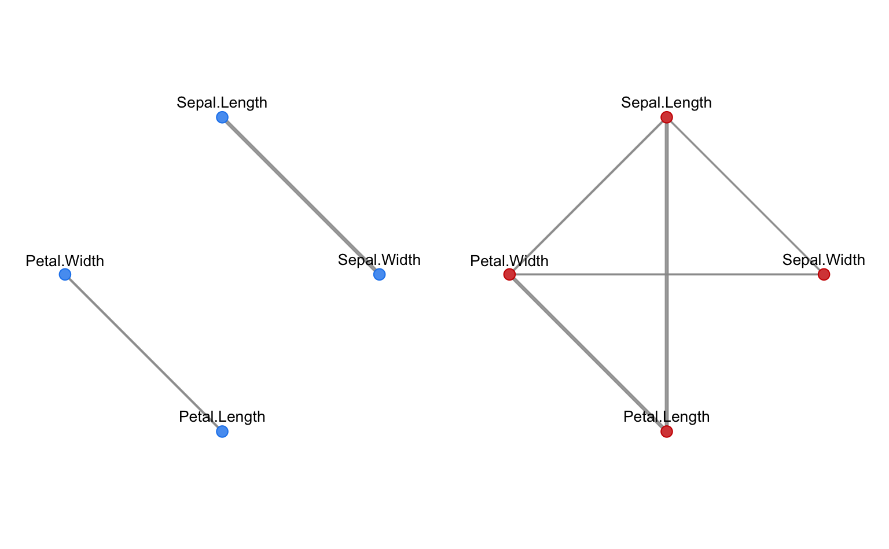

\
[`plot`](https://rdrr.io/r/graphics/plot.default.html)`(``mod``, what ``=`` ``"adjacency"``)`

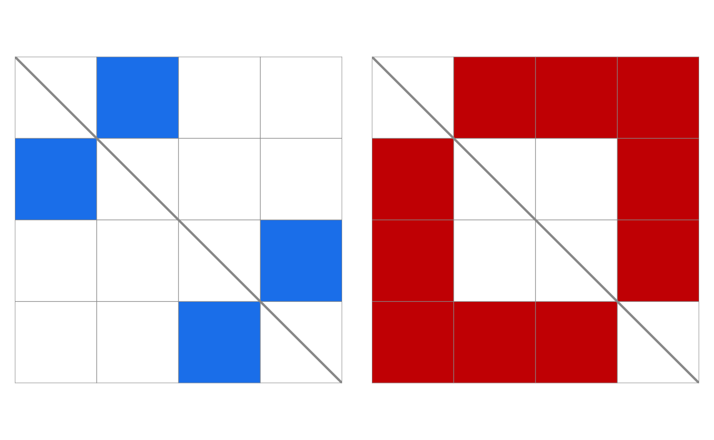

\
[`plot`](https://rdrr.io/r/graphics/plot.default.html)`(``mod``, what ``=`` ``"classification"``)`

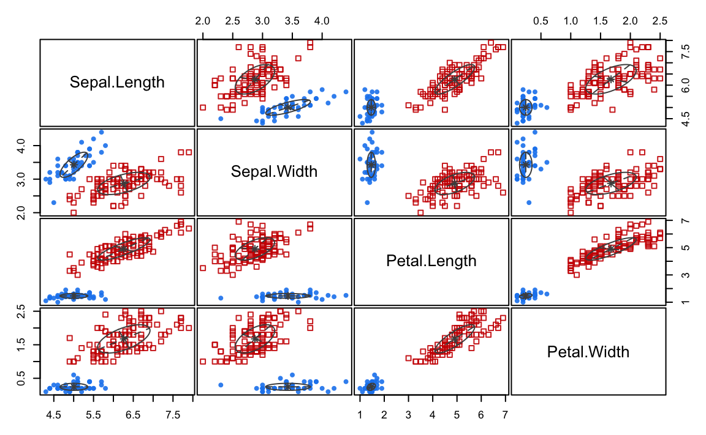

\
[`plot`](https://rdrr.io/r/graphics/plot.default.html)`(``mod``, what ``=`` ``"common"``)`

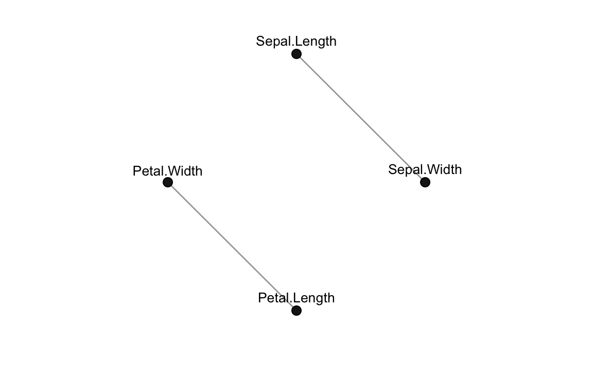

### A complex simulated data example

\
`N`` ``=`` ``500`\
`V`` ``=`` ``20`\
`tau`` ``=`` `[`c`](https://rdrr.io/r/base/c.html)`(``0.3``, ``0.7``)`\
`Nk`` ``=`` `[`rowSums`](https://rdrr.io/r/base/colSums.html)`(`` `[`rmultinom`](https://rdrr.io/r/stats/Multinom.html)`(``N``, ``1``, ``tau``)`` ``)`\
`class`` ``=`` `[`rep`](https://rdrr.io/r/base/rep.html)`(``1``:``2``, ``Nk``)`\
`sigma1`` ``=`` `[`rWishart`](https://rdrr.io/r/stats/rWishart.html)`(``1``, ``V``+``1``, `[`diag`](https://rdrr.io/r/base/diag.html)`(``V``)``)``[``,,``1``]`\
`mu1`` ``=`` `[`rep`](https://rdrr.io/r/base/rep.html)`(``0``, ``V``)`\
`mu2`` ``=`` `[`rnorm`](https://rdrr.io/r/stats/Normal.html)`(``V``, ``0.5``, ``2``)`\
`x1`` ``=`` ``MASS``::`[`mvrnorm`](https://rdrr.io/pkg/MASS/man/mvrnorm.html)`(``Nk``[``1``]``, ``mu1``, ``sigma1``)`\
`x2`` ``=`` `[`matrix`](https://rdrr.io/r/base/matrix.html)`(``NA``, ``Nk``[``2``]``, ``V``)`\
`x2``[``,``1``]`` ``=`` `[`rnorm`](https://rdrr.io/r/stats/Normal.html)`(``Nk``[``2``]``)`\
`for``(``j`` ``in`` ``2``:``V``)`` `\
`  ``x2``[``,``j``]`` ``=`` ``x2``[``,``j``-``1``]`` ``+`` `[`rnorm`](https://rdrr.io/r/stats/Normal.html)`(``Nk``[``2``]``, ``mu2``[``j``]``, sd ``=`` ``0.5``)`\
`x`` ``=`` `[`rbind`](https://rdrr.io/r/base/cbind.html)`(``x1``, ``x2``)`\
[`colnames`](https://rdrr.io/r/base/colnames.html)`(``x``)`` ``=`` `[`paste0`](https://rdrr.io/r/base/paste.html)`(``"x"``, ``1``:`[`ncol`](https://rdrr.io/r/base/nrow.html)`(``x``)``)`

\
`mod`` ``=`` `[`mixGGM`](../reference/mixGGM.md)`(``x``, K ``=`` ``1``:``4``, model ``=`` ``"concentration"``,`\
`             penalty ``=`` ``"ebic"``, beta ``=`` ``0.5``)`

\
[`summary`](https://rdrr.io/r/base/summary.html)`(``mod``)`\
`## ── ``Mixture of Gaussian graphical models`` ──────────────────── `\
`## `\
`## Data dimensions = 500 x 20 `\
`## Model           = concentration `\
`## Search          = forward-stepwise `\
`## Penalty         = ebic `\
`## `\
`##  Log-likelihood Pen. log-likelihood  df       BIC`\
`##       -13384.86           -13818.17 152 -27714.33`\
`## `\
`## Graphs:`\
`## [,,1]                                           `\
`## x1  ◯ ◯ ◯ ◉ ◯ ◯ ◯ ◯ ◯ ◯ ◉ ◯ ◯ ◯ ◯ ◯ ◉ ◉ ◯ ◯`\
`## x2  ◯ ◯ ◯ ◉ ◯ ◯ ◯ ◯ ◯ ◯ ◯ ◉ ◯ ◉ ◉ ◯ ◯ ◉ ◯ ◯`\
`## x3  ◯ ◯ ◯ ◯ ◯ ◯ ◉ ◯ ◯ ◯ ◯ ◉ ◯ ◯ ◉ ◯ ◯ ◯ ◉ ◉`\
`## x4  ◉ ◉ ◯ ◯ ◯ ◯ ◉ ◯ ◯ ◉ ◯ ◉ ◯ ◯ ◯ ◯ ◯ ◉ ◯ ◉`\
`## x5  ◯ ◯ ◯ ◯ ◯ ◯ ◯ ◉ ◯ ◯ ◉ ◯ ◯ ◉ ◯ ◯ ◯ ◯ ◯ ◯`\
`## x6  ◯ ◯ ◯ ◯ ◯ ◯ ◯ ◉ ◉ ◉ ◯ ◯ ◯ ◯ ◯ ◯ ◉ ◯ ◯ ◯`\
`## x7  ◯ ◯ ◉ ◉ ◯ ◯ ◯ ◯ ◯ ◉ ◉ ◯ ◯ ◯ ◉ ◯ ◯ ◯ ◉ ◯`\
`## x8  ◯ ◯ ◯ ◯ ◉ ◉ ◯ ◯ ◯ ◯ ◯ ◯ ◯ ◯ ◯ ◯ ◉ ◯ ◉ ◯`\
`## x9  ◯ ◯ ◯ ◯ ◯ ◉ ◯ ◯ ◯ ◉ ◉ ◯ ◯ ◉ ◯ ◯ ◯ ◯ ◯ ◯`\
`## x10 ◯ ◯ ◯ ◉ ◯ ◉ ◉ ◯ ◉ ◯ ◉ ◯ ◯ ◯ ◉ ◯ ◯ ◉ ◯ ◉`\
`## x11 ◉ ◯ ◯ ◯ ◉ ◯ ◉ ◯ ◉ ◉ ◯ ◯ ◉ ◉ ◯ ◯ ◉ ◉ ◯ ◯`\
`## x12 ◯ ◉ ◉ ◉ ◯ ◯ ◯ ◯ ◯ ◯ ◯ ◯ ◯ ◉ ◯ ◯ ◯ ◉ ◯ ◯`\
`## x13 ◯ ◯ ◯ ◯ ◯ ◯ ◯ ◯ ◯ ◯ ◉ ◯ ◯ ◯ ◯ ◯ ◯ ◯ ◯ ◯`\
`## x14 ◯ ◉ ◯ ◯ ◉ ◯ ◯ ◯ ◉ ◯ ◉ ◉ ◯ ◯ ◯ ◯ ◯ ◯ ◯ ◯`\
`## x15 ◯ ◉ ◉ ◯ ◯ ◯ ◉ ◯ ◯ ◉ ◯ ◯ ◯ ◯ ◯ ◯ ◯ ◯ ◉ ◉`\
`## x16 ◯ ◯ ◯ ◯ ◯ ◯ ◯ ◯ ◯ ◯ ◯ ◯ ◯ ◯ ◯ ◯ ◉ ◉ ◯ ◉`\
`## x17 ◉ ◯ ◯ ◯ ◯ ◉ ◯ ◉ ◯ ◯ ◉ ◯ ◯ ◯ ◯ ◉ ◯ ◯ ◯ ◯`\
`## x18 ◉ ◉ ◯ ◉ ◯ ◯ ◯ ◯ ◯ ◉ ◉ ◉ ◯ ◯ ◯ ◉ ◯ ◯ ◉ ◉`\
`## x19 ◯ ◯ ◉ ◯ ◯ ◯ ◉ ◉ ◯ ◯ ◯ ◯ ◯ ◯ ◉ ◯ ◯ ◉ ◯ ◯`\
`## x20 ◯ ◯ ◉ ◉ ◯ ◯ ◯ ◯ ◯ ◉ ◯ ◯ ◯ ◯ ◉ ◉ ◯ ◉ ◯ ◯`\
`## [,,2]                                           `\
`## x1  ◯ ◉ ◯ ◯ ◯ ◯ ◯ ◯ ◯ ◯ ◯ ◯ ◯ ◯ ◯ ◯ ◯ ◯ ◯ ◯`\
`## x2  ◉ ◯ ◉ ◯ ◯ ◯ ◯ ◯ ◯ ◯ ◯ ◯ ◯ ◯ ◯ ◯ ◯ ◯ ◯ ◯`\
`## x3  ◯ ◉ ◯ ◉ ◯ ◯ ◯ ◯ ◯ ◯ ◯ ◯ ◯ ◯ ◯ ◯ ◯ ◯ ◯ ◯`\
`## x4  ◯ ◯ ◉ ◯ ◉ ◯ ◯ ◯ ◯ ◯ ◯ ◯ ◯ ◯ ◯ ◯ ◯ ◯ ◯ ◯`\
`## x5  ◯ ◯ ◯ ◉ ◯ ◉ ◯ ◯ ◯ ◯ ◯ ◯ ◯ ◯ ◯ ◯ ◯ ◯ ◯ ◯`\
`## x6  ◯ ◯ ◯ ◯ ◉ ◯ ◉ ◯ ◯ ◯ ◯ ◯ ◯ ◯ ◯ ◯ ◯ ◯ ◯ ◯`\
`## x7  ◯ ◯ ◯ ◯ ◯ ◉ ◯ ◉ ◯ ◯ ◯ ◯ ◯ ◯ ◯ ◯ ◯ ◯ ◯ ◯`\
`## x8  ◯ ◯ ◯ ◯ ◯ ◯ ◉ ◯ ◉ ◯ ◯ ◯ ◯ ◯ ◯ ◯ ◯ ◯ ◯ ◯`\
`## x9  ◯ ◯ ◯ ◯ ◯ ◯ ◯ ◉ ◯ ◉ ◯ ◯ ◯ ◯ ◯ ◯ ◯ ◯ ◯ ◯`\
`## x10 ◯ ◯ ◯ ◯ ◯ ◯ ◯ ◯ ◉ ◯ ◉ ◯ ◯ ◯ ◯ ◯ ◯ ◯ ◯ ◯`\
`## x11 ◯ ◯ ◯ ◯ ◯ ◯ ◯ ◯ ◯ ◉ ◯ ◉ ◯ ◯ ◯ ◯ ◯ ◯ ◯ ◯`\
`## x12 ◯ ◯ ◯ ◯ ◯ ◯ ◯ ◯ ◯ ◯ ◉ ◯ ◉ ◯ ◯ ◯ ◯ ◯ ◯ ◯`\
`## x13 ◯ ◯ ◯ ◯ ◯ ◯ ◯ ◯ ◯ ◯ ◯ ◉ ◯ ◉ ◯ ◯ ◯ ◯ ◯ ◯`\
`## x14 ◯ ◯ ◯ ◯ ◯ ◯ ◯ ◯ ◯ ◯ ◯ ◯ ◉ ◯ ◉ ◯ ◯ ◯ ◯ ◯`\
`## x15 ◯ ◯ ◯ ◯ ◯ ◯ ◯ ◯ ◯ ◯ ◯ ◯ ◯ ◉ ◯ ◉ ◯ ◯ ◯ ◯`\
`## x16 ◯ ◯ ◯ ◯ ◯ ◯ ◯ ◯ ◯ ◯ ◯ ◯ ◯ ◯ ◉ ◯ ◉ ◯ ◯ ◯`\
`## x17 ◯ ◯ ◯ ◯ ◯ ◯ ◯ ◯ ◯ ◯ ◯ ◯ ◯ ◯ ◯ ◉ ◯ ◉ ◯ ◯`\
`## x18 ◯ ◯ ◯ ◯ ◯ ◯ ◯ ◯ ◯ ◯ ◯ ◯ ◯ ◯ ◯ ◯ ◉ ◯ ◉ ◯`\
`## x19 ◯ ◯ ◯ ◯ ◯ ◯ ◯ ◯ ◯ ◯ ◯ ◯ ◯ ◯ ◯ ◯ ◯ ◉ ◯ ◉`\
`## x20 ◯ ◯ ◯ ◯ ◯ ◯ ◯ ◯ ◯ ◯ ◯ ◯ ◯ ◯ ◯ ◯ ◯ ◯ ◉ ◯`

\
[`plot`](https://rdrr.io/r/graphics/plot.default.html)`(``mod``, what ``=`` ``"classification"``, dimens ``=`` `[`c`](https://rdrr.io/r/base/c.html)`(``1``,``5``,``10``,``15``,``20``)``)`

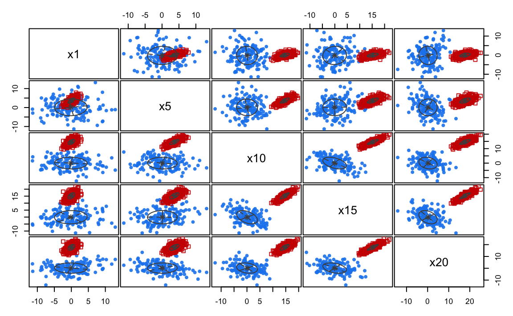

\
[`plot`](https://rdrr.io/r/graphics/plot.default.html)`(``mod``, what ``=`` ``"graph"``)`

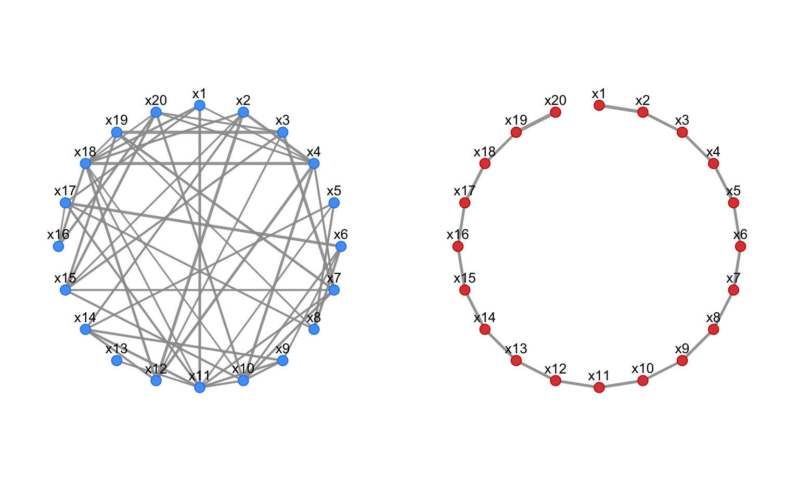

\
[`plot`](https://rdrr.io/r/graphics/plot.default.html)`(``mod``, what ``=`` ``"adjacency"``)`

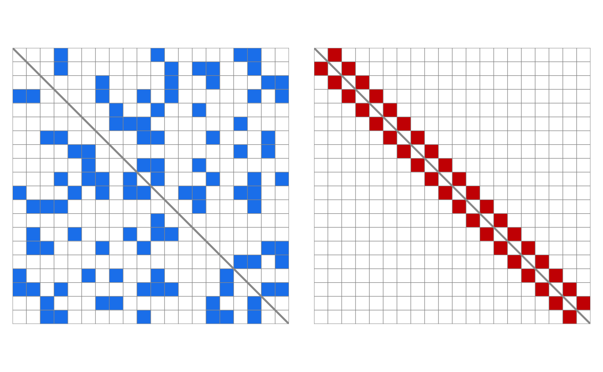

\
[`table`](https://rdrr.io/r/base/table.html)`(``class``, ``mod``$``classification``)`\
`##      `\
`## class   1   2`\
`##     1 145   0`\
`##     2   0 355`

## Fit a mixture of covariance graph models

### Wine data

\
[`data`](https://rdrr.io/r/utils/data.html)`(``wine``, package ``=`` ``"gclus"``)`

\
`mod`` ``=`` `[`mixGGM`](../reference/mixGGM.md)`(``wine``[``,``-``1``]``, K ``=`` ``1``:``4``, model ``=`` ``"covariance"``,`\
`             penalty ``=`` ``"erdos"``, beta ``=`` ``0.01``)`

\
[`summary`](https://rdrr.io/r/base/summary.html)`(``mod``, graphs ``=`` ``TRUE``)`\
`## ── ``Mixture of Gaussian graphical models`` ──────────────────── `\
`## `\
`## Data dimensions = 178 x 13 `\
`## Model           = covariance `\
`## Search          = forward-stepwise `\
`## Penalty         = erdos `\
`## `\
`##  Log-likelihood Pen. log-likelihood  df       BIC`\
`##       -3049.506           -3175.926 107 -6653.463`\
`## `\
`## Graphs:`\
`## [,,1]                                         `\
`## Alcohol         ◯ ◯ ◯ ◯ ◯ ◯ ◯ ◯ ◯ ◯ ◯ ◯ ◯`\
`## Malic           ◯ ◯ ◯ ◯ ◯ ◯ ◯ ◯ ◯ ◯ ◯ ◯ ◯`\
`## Ash             ◯ ◯ ◯ ◯ ◯ ◯ ◯ ◯ ◯ ◯ ◯ ◯ ◯`\
`## Alcalinity      ◯ ◯ ◯ ◯ ◉ ◯ ◯ ◯ ◯ ◯ ◯ ◯ ◯`\
`## Magnesium       ◯ ◯ ◯ ◉ ◯ ◯ ◯ ◯ ◯ ◯ ◯ ◯ ◯`\
`## Phenols         ◯ ◯ ◯ ◯ ◯ ◯ ◉ ◯ ◯ ◉ ◯ ◯ ◯`\
`## Flavanoids      ◯ ◯ ◯ ◯ ◯ ◉ ◯ ◯ ◯ ◉ ◯ ◯ ◯`\
`## Nonflavanoid    ◯ ◯ ◯ ◯ ◯ ◯ ◯ ◯ ◯ ◯ ◯ ◯ ◯`\
`## Proanthocyanins ◯ ◯ ◯ ◯ ◯ ◯ ◯ ◯ ◯ ◯ ◯ ◯ ◯`\
`## Intensity       ◯ ◯ ◯ ◯ ◯ ◉ ◉ ◯ ◯ ◯ ◯ ◯ ◉`\
`## Hue             ◯ ◯ ◯ ◯ ◯ ◯ ◯ ◯ ◯ ◯ ◯ ◯ ◯`\
`## OD280           ◯ ◯ ◯ ◯ ◯ ◯ ◯ ◯ ◯ ◯ ◯ ◯ ◯`\
`## Proline         ◯ ◯ ◯ ◯ ◯ ◯ ◯ ◯ ◯ ◉ ◯ ◯ ◯`\
`## [,,2]                                         `\
`## Alcohol         ◯ ◯ ◯ ◯ ◯ ◯ ◯ ◯ ◯ ◉ ◯ ◯ ◯`\
`## Malic           ◯ ◯ ◯ ◯ ◯ ◯ ◯ ◯ ◯ ◯ ◯ ◯ ◯`\
`## Ash             ◯ ◯ ◯ ◉ ◯ ◯ ◯ ◯ ◯ ◯ ◯ ◯ ◯`\
`## Alcalinity      ◯ ◯ ◉ ◯ ◯ ◯ ◯ ◯ ◯ ◯ ◯ ◯ ◯`\
`## Magnesium       ◯ ◯ ◯ ◯ ◯ ◯ ◉ ◉ ◉ ◯ ◯ ◯ ◉`\
`## Phenols         ◯ ◯ ◯ ◯ ◯ ◯ ◯ ◉ ◉ ◯ ◯ ◯ ◯`\
`## Flavanoids      ◯ ◯ ◯ ◯ ◉ ◯ ◯ ◉ ◉ ◯ ◯ ◯ ◯`\
`## Nonflavanoid    ◯ ◯ ◯ ◯ ◉ ◉ ◉ ◯ ◯ ◯ ◯ ◯ ◯`\
`## Proanthocyanins ◯ ◯ ◯ ◯ ◉ ◉ ◉ ◯ ◯ ◯ ◯ ◯ ◉`\
`## Intensity       ◉ ◯ ◯ ◯ ◯ ◯ ◯ ◯ ◯ ◯ ◉ ◯ ◯`\
`## Hue             ◯ ◯ ◯ ◯ ◯ ◯ ◯ ◯ ◯ ◉ ◯ ◉ ◯`\
`## OD280           ◯ ◯ ◯ ◯ ◯ ◯ ◯ ◯ ◯ ◯ ◉ ◯ ◯`\
`## Proline         ◯ ◯ ◯ ◯ ◉ ◯ ◯ ◯ ◉ ◯ ◯ ◯ ◯`\
`## [,,3]                                         `\
`## Alcohol         ◯ ◯ ◯ ◯ ◯ ◯ ◯ ◯ ◯ ◯ ◯ ◯ ◯`\
`## Malic           ◯ ◯ ◯ ◯ ◯ ◯ ◯ ◯ ◯ ◯ ◉ ◯ ◯`\
`## Ash             ◯ ◯ ◯ ◉ ◉ ◯ ◯ ◯ ◯ ◯ ◯ ◯ ◯`\
`## Alcalinity      ◯ ◯ ◉ ◯ ◯ ◯ ◯ ◯ ◯ ◯ ◯ ◯ ◯`\
`## Magnesium       ◯ ◯ ◉ ◯ ◯ ◯ ◯ ◯ ◯ ◯ ◯ ◯ ◯`\
`## Phenols         ◯ ◯ ◯ ◯ ◯ ◯ ◉ ◉ ◯ ◯ ◯ ◯ ◯`\
`## Flavanoids      ◯ ◯ ◯ ◯ ◯ ◉ ◯ ◯ ◉ ◉ ◯ ◉ ◯`\
`## Nonflavanoid    ◯ ◯ ◯ ◯ ◯ ◉ ◯ ◯ ◯ ◯ ◯ ◯ ◯`\
`## Proanthocyanins ◯ ◯ ◯ ◯ ◯ ◯ ◉ ◯ ◯ ◯ ◯ ◉ ◯`\
`## Intensity       ◯ ◯ ◯ ◯ ◯ ◯ ◉ ◯ ◯ ◯ ◯ ◯ ◯`\
`## Hue             ◯ ◉ ◯ ◯ ◯ ◯ ◯ ◯ ◯ ◯ ◯ ◯ ◯`\
`## OD280           ◯ ◯ ◯ ◯ ◯ ◯ ◉ ◯ ◉ ◯ ◯ ◯ ◯`\
`## Proline         ◯ ◯ ◯ ◯ ◯ ◯ ◯ ◯ ◯ ◯ ◯ ◯ ◯`

\
[`plot`](https://rdrr.io/r/graphics/plot.default.html)`(``mod``, what ``=`` ``"graph"``)`

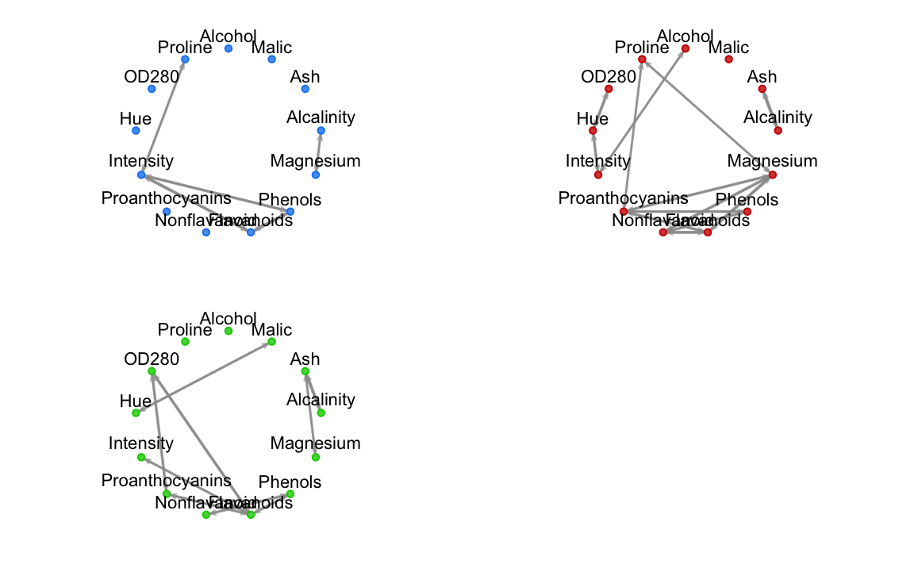

\
[`plot`](https://rdrr.io/r/graphics/plot.default.html)`(``mod``, what ``=`` ``"adjacency"``)`

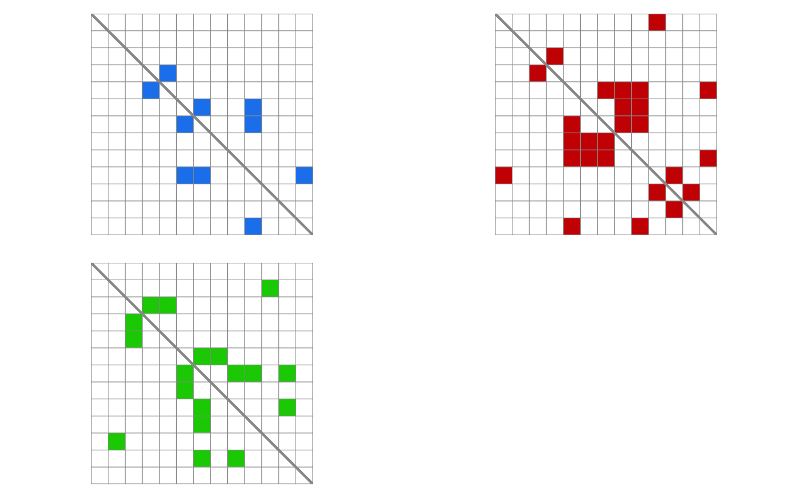

\
[`plot`](https://rdrr.io/r/graphics/plot.default.html)`(``mod``, what ``=`` ``"classification"``, dimens ``=`` ``1``:``4``)`

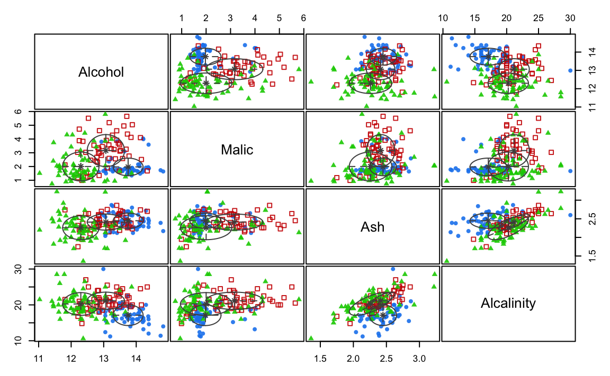

\
[`table`](https://rdrr.io/r/base/table.html)`(``wine``$``Class``, ``mod``$``classification``)`\
`##    `\
`##      1  2  3`\
`##   1 57  0  2`\
`##   2  1  5 65`\
`##   3  0 48  0`\
`mclust``::`[`adjustedRandIndex`](https://mclust-org.github.io/mclust/reference/adjustedRandIndex.html)`(``wine``$``Class``, ``mod``$``classification``)`\
`## [1] 0.8667189`

### A simple simulated data example

\
`N`` ``=`` ``200`\
`tau`` ``=`` `[`c`](https://rdrr.io/r/base/c.html)`(``0.3``, ``0.7``)`\
`Nk`` ``=`` `[`rowSums`](https://rdrr.io/r/base/colSums.html)`(`` `[`rmultinom`](https://rdrr.io/r/stats/Multinom.html)`(``N``, ``1``, ``tau``)`` ``)`\
`class`` ``=`` `[`rep`](https://rdrr.io/r/base/rep.html)`(``1``:``2``, ``Nk``)`\
`sigma1`` ``=`` `[`diag`](https://rdrr.io/r/base/diag.html)`(``2``)``                          ``# independent variables`\
`sigma2`` ``=`` `[`matrix`](https://rdrr.io/r/base/matrix.html)`(`` `[`c`](https://rdrr.io/r/base/c.html)`(``1``,``0.9``,``0.9``,``1``)``, ``2``,``2`` ``)``    ``# correlated variables`\
`mu1`` ``=`` `[`c`](https://rdrr.io/r/base/c.html)`(``0``, ``0``)`\
`mu2`` ``=`` `[`c`](https://rdrr.io/r/base/c.html)`(``2``, ``3``)`\
`x`` ``=`` `[`rbind`](https://rdrr.io/r/base/cbind.html)`(``MASS``::`[`mvrnorm`](https://rdrr.io/pkg/MASS/man/mvrnorm.html)`(``Nk``[``1``]``, ``mu1``, ``sigma1``)``,`\
`           ``MASS``::`[`mvrnorm`](https://rdrr.io/pkg/MASS/man/mvrnorm.html)`(``Nk``[``2``]``, ``mu2``, ``sigma2``)``)`\
[`colnames`](https://rdrr.io/r/base/colnames.html)`(``x``)`` ``=`` `[`paste0`](https://rdrr.io/r/base/paste.html)`(``"x"``, ``1``:`[`ncol`](https://rdrr.io/r/base/nrow.html)`(``x``)``)`\
`mod`` ``=`` `[`mixGGM`](../reference/mixGGM.md)`(``x``, model ``=`` ``"covariance"``)`\
[`summary`](https://rdrr.io/r/base/summary.html)`(``mod``, graphs ``=`` ``TRUE``, parameters ``=`` ``TRUE``)`\
`## ── ``Mixture of Gaussian graphical models`` ──────────────────── `\
`## `\
`## Data dimensions = 200 x 2 `\
`## Model           = covariance `\
`## Search          = forward-stepwise `\
`## Penalty         = bic `\
`## `\
`##  Log-likelihood Pen. log-likelihood df      BIC`\
`##       -549.7835           -552.4326 10 -1152.55`\
`## `\
`## Graphs:`\
`## [,,1]      `\
`## x1 ◯ ◯`\
`## x2 ◯ ◯`\
`## [,,2]      `\
`## x1 ◯ ◉`\
`## x2 ◉ ◯`\
`## `\
`## Mixing probabilities:`\
`## [1] 0.2701669 0.7298331`\
`## `\
`## Means:`\
`##              1        2`\
`## x1 -0.04346726 1.948327`\
`## x2  0.02859949 2.939030`\
`## `\
`## Covariances:`\
`## [,,1]`\
`##          x1        x2`\
`## x1 1.059458 0.0000000`\
`## x2 0.000000 0.9923883`\
`## [,,2]`\
`##          x1        x2`\
`## x1 1.059034 0.9158390`\
`## x2 0.915839 0.9822129`

\
[`plot`](https://rdrr.io/r/graphics/plot.default.html)`(``mod``, what ``=`` ``"graph"``)`

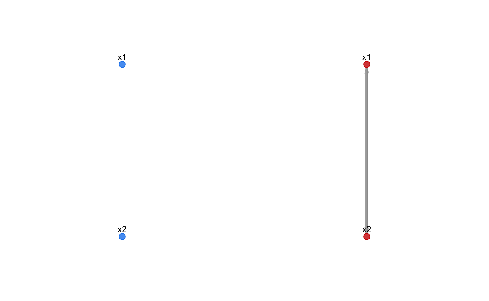

\
[`plot`](https://rdrr.io/r/graphics/plot.default.html)`(``mod``, what ``=`` ``"adjacency"``)`

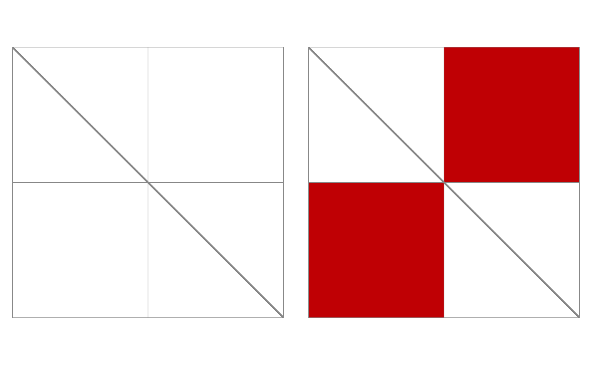

\
[`plot`](https://rdrr.io/r/graphics/plot.default.html)`(``mod``, what ``=`` ``"classification"``)`

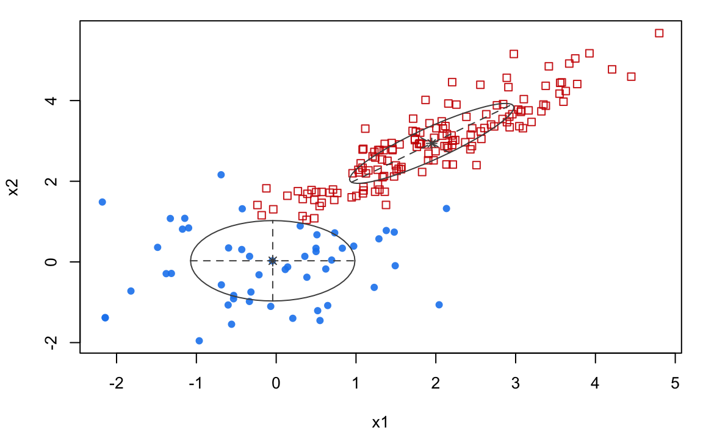

\

## References

Fop M, Murphy TB, Scrucca L (2019). “Model-based clustering with sparse
covariance matrices.” *Statistics and Computing*, **29**(4), 791–819.
ISSN 1573-1375.
[doi:10.1007/s11222-018-9838-y](https://doi.org/10.1007/s11222-018-9838-y).

------------------------------------------------------------------------

\
`devtools``::`[`session_info`](https://sessioninfo.r-lib.org/reference/session_info.html)`(``)`\
`## ``─ Session info ───────────────────────────────────────────────────────────────`\
`##  ``setting `` ``value`\
`##  version  R version 4.6.2 (2026-10-29)`\
`##  os       macOS Golden Gate 27.2.1`\
`##  system   aarch64, darwin23`\
`##  ui       X11`\
`##  language en`\
`##  collate  en_US.UTF-8`\
`##  ctype    en_US.UTF-8`\
`##  tz       Europe/Rome`\
`##  date     2026-11-19`\
`##  pandoc   3.14 @ /opt/homebrew/bin/ (via rmarkdown)`\
`##  quarto   1.11.9 @ /usr/local/bin/quarto`\
`## `\
`## ``─ Packages ───────────────────────────────────────────────────────────────────`\
`##  ``package       `` ``*`` ``version `` ``date (UTC)`` ``lib`` ``source`\
`##  bslib            0.12.0   ``2026-08-04`` ``[2]`` ``CRAN (R 4.6.1)`\
`##  cachem           1.1.0    ``2024-05-16`` ``[2]`` ``CRAN (R 4.6.0)`\
`##  cli              3.6.6    ``2026-04-09`` ``[2]`` ``CRAN (R 4.6.0)`\
`##  coda             0.19-4.1 ``2024-01-31`` ``[2]`` ``CRAN (R 4.6.0)`\
`##  codetools        0.2-20   ``2024-03-31`` ``[3]`` ``CRAN (R 4.6.2)`\
`##  crayon           1.5.3    ``2024-06-20`` ``[2]`` ``CRAN (R 4.6.0)`\
`##  desc             1.4.3    ``2023-12-10`` ``[2]`` ``CRAN (R 4.6.0)`\
`##  devtools         2.5.2    ``2026-04-30`` ``[2]`` ``CRAN (R 4.6.0)`\
`##  digest           0.6.39   ``2025-11-19`` ``[2]`` ``CRAN (R 4.6.0)`\
`##  ellipsis         0.3.3    ``2026-04-04`` ``[2]`` ``CRAN (R 4.6.0)`\
`##  evaluate         1.0.5    ``2025-08-27`` ``[2]`` ``CRAN (R 4.6.0)`\
`##  fastmap          1.2.0    ``2024-05-15`` ``[2]`` ``CRAN (R 4.6.0)`\
`##  foreach          1.5.2    ``2022-02-02`` ``[2]`` ``CRAN (R 4.6.0)`\
`##  fs               2.1.0    ``2026-04-18`` ``[2]`` ``CRAN (R 4.6.0)`\
`##  glue             1.8.1    ``2026-04-17`` ``[2]`` ``CRAN (R 4.6.0)`\
`##  htmltools        0.5.9    ``2025-12-04`` ``[2]`` ``CRAN (R 4.6.0)`\
`##  htmlwidgets      1.6.4    ``2023-12-06`` ``[2]`` ``CRAN (R 4.6.0)`\
`##  iterators        1.0.14   ``2022-02-05`` ``[2]`` ``CRAN (R 4.6.0)`\
`##  jquerylib        0.1.4    ``2021-04-26`` ``[2]`` ``CRAN (R 4.6.0)`\
`##  jsonlite         2.0.0    ``2025-03-27`` ``[2]`` ``CRAN (R 4.6.0)`\
`##  knitr          * 1.52     ``2026-09-06`` ``[2]`` ``CRAN (R 4.6.1)`\
`##  lattice          0.23-1   ``2026-08-12`` ``[2]`` ``CRAN (R 4.6.1)`\
`##  lifecycle        1.0.5    ``2026-01-08`` ``[2]`` ``CRAN (R 4.6.0)`\
`##  magrittr         2.0.5    ``2026-04-04`` ``[2]`` ``CRAN (R 4.6.0)`\
`##  MASS             7.3-66   ``2026-07-15`` ``[3]`` ``CRAN (R 4.6.2)`\
`##  mclust           6.1.4    ``2026-11-18`` ``[2]`` ``CRAN (R 4.6.2)`\
`##  memoise          2.0.1    ``2021-11-26`` ``[2]`` ``CRAN (R 4.6.0)`\
`##  mixggm         * 1.2      ``2026-11-19`` ``[1]`` ``CRAN (R 4.6.2)`\
`##  network          1.20.0   ``2026-02-07`` ``[2]`` ``CRAN (R 4.6.0)`\
`##  otel             0.2.0    ``2025-08-29`` ``[2]`` ``CRAN (R 4.6.0)`\
`##  pillar           1.11.1   ``2025-09-17`` ``[2]`` ``CRAN (R 4.6.0)`\
`##  pkgbuild         1.4.8    ``2025-05-26`` ``[2]`` ``CRAN (R 4.6.0)`\
`##  pkgconfig        2.0.3    ``2019-09-22`` ``[2]`` ``CRAN (R 4.6.0)`\
`##  pkgdown          2.2.1    ``2026-07-07`` ``[2]`` ``CRAN (R 4.6.1)`\
`##  pkgload          1.5.3    ``2026-06-15`` ``[2]`` ``CRAN (R 4.6.0)`\
`##  purrr            1.2.2    ``2026-04-10`` ``[2]`` ``CRAN (R 4.6.0)`\
`##  R6               2.6.1    ``2025-02-15`` ``[2]`` ``CRAN (R 4.6.0)`\
`##  Rcpp             1.1.2    ``2026-07-05`` ``[2]`` ``CRAN (R 4.6.1)`\
`##  rlang            1.3.0    ``2026-07-05`` ``[2]`` ``CRAN (R 4.6.1)`\
`##  rmarkdown        2.32     ``2026-09-01`` ``[2]`` ``CRAN (R 4.6.1)`\
`##  rstudioapi       0.19.0   ``2026-06-11`` ``[2]`` ``CRAN (R 4.6.0)`\
`##  sass             0.4.10   ``2025-04-11`` ``[2]`` ``CRAN (R 4.6.0)`\
`##  sessioninfo      1.2.4    ``2026-06-04`` ``[2]`` ``CRAN (R 4.6.0)`\
`##  statnet.common   4.13.0   ``2025-12-16`` ``[2]`` ``CRAN (R 4.6.0)`\
`##  tibble           3.3.1    ``2026-01-11`` ``[2]`` ``CRAN (R 4.6.0)`\
`##  usethis          3.2.2    ``2026-09-10`` ``[2]`` ``CRAN (R 4.6.1)`\
`##  vctrs            0.7.3    ``2026-04-11`` ``[2]`` ``CRAN (R 4.6.0)`\
`##  xfun             0.62     ``2026-10-16`` ``[2]`` ``CRAN (R 4.6.1)`\
`##  yaml             2.3.12   ``2025-12-10`` ``[2]`` ``CRAN (R 4.6.0)`\
`## `\
`## `` [1] /private/var/folders/fw/kxwccvv11xdc27jbny1b8rth0000gn/T/RtmpKTSRQb/temp_libpath51521f970031`\
`## `` [2] /Library/Frameworks/R.framework/Rlib`\
`## `` [3] /Library/Frameworks/R.framework/Versions/4.6/Resources/library`\
`##  ``*`` ── Packages attached to the search path.`\
`## `\
`## ``──────────────────────────────────────────────────────────────────────────────`
